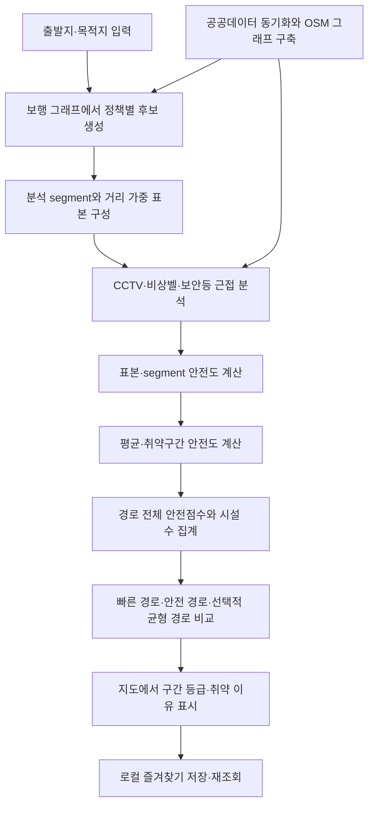

# 밤길 지킴이 기능 명세서
## Functional Specification · Android / Kotlin

이 문서는 기능 요구사항과 인수 기준입니다. **현재 구현·검증 상태와 작업 순서는 [전체 로드맵](../ROADMAP.md)을 기준으로 확인합니다.** 본문의 2026-10-05 조사·설계 당시 표현은 과거 전제이며 현재 상태 보고가 아닙니다. 2026-11-04 개정은 [MVP 점수 정책](night-safety-mvp-scoring-policy-ko.md)을 반영해 자료 기간 상한을 제거하고 조명 유형을 보안등으로 변경합니다. 새 계약의 코드·DB·APK 실제 적용과 기본 검증은 [2026-11-04 적용 기록](../source/verification/mvp-scoring-2026-11-04/verification.md)을 따릅니다. 명세 전체 인수 완료를 의미하지 않습니다.

| 문서 항목 | 내용 |
| --- | --- |
| 문서 버전 | 1.2 (MVP 점수·자료 표시 정책 개정) |
| 작성일 | 2026-10-05 |
| 최종 수정일 | 2026-11-04 (Asia/Seoul) |
| 대상 | 교수자, 프로젝트 개발자 |
| 문서 목적 | 기능 구현, DB·API 설계, 인수 테스트의 공통 기준 |
| 작성 당시 상태 (2026-10-05) | 설계 명세 작성 당시에는 Android 프로젝트 없이 Python OSM 실험·공공데이터·검토 자료가 존재했음. 현재 상태는 전체 로드맵 참조. |
| 의사결정 수준 | 아래 입출력·상태·계산 규칙은 권장 구현 기준. 수치 가중치·반경·등급 경계·성능 목표는 실험 초깃값이며 설정 버전으로 변경함 |
| 사용자 | 회원가입 없이 이용하는 보행자. 데이터 운영자는 팀 내부 역할이며 일반 앱 사용자와 분리 |
| 범위 | 서비스 대상은 경기도 시흥시. 검증된 대학 주변 구간에서 먼저 통합하고, 지역별 데이터·그래프를 추가하여 확대 |

## 목차

- [1. 프로젝트 개요와 범위](#section-1)
- [2. 권장 구현 구조](#section-2)
- [3. 공통 기능 규칙과 계산 계약](#section-3)
- [4. 기능별 상세 명세](#section-4)
- [5. 기능 전체 목록](#section-5)
- [6. 화면–기능 매핑](#section-6)
- [7. 기능–데이터 매핑](#section-7)
- [8. 기능–API 매핑](#section-8)
- [9. API 계약](#section-9)
- [10. DB 설계 기준](#section-10)
- [11. 테스트·인수 기준](#section-11)
- [12. 기능 명세 검토](#section-12)
- [13. 추가 제안 기능](#section-13)
- [14. 구현 전 확정·검증 항목](#section-14)
- [15. 근거와 문서 적용 범위](#section-15)

<a id="section-1"></a>

## 1. 프로젝트 개요와 범위

밤길 지킴이는 출발지와 목적지를 입력한 사용자에게 빠른 경로와 안전 우선 경로를 제공하고, 각 경로의 시설 기반 안전지표와 취약구간을 비교하도록 돕는 Android 앱이다. Kotlin으로 구현하며 회원가입을 요구하지 않는다. 즐겨찾기는 기기 내에 저장한다.

핵심 흐름은 다음과 같다.



후보 생성에 사용할 시설 지표는 그래프 구축 이후 미리 계산한다. 위 흐름에서 후보별 분석은 사전 계산한 지표를 원본 edge 순서에 맞춰 조합하고, 요청 시점의 그래프·시설·설정 버전 일치를 검증하는 단계이다. 출발·도착 edge의 일부만 사용하는 경우 해당 부분을 다시 평가한다.

### 1.1 우선순위와 난이도

| 구분 | 의미 |
| --- | --- |
| P0 | 프로젝트 핵심 시연에 필수. 자체 안전경로·segment 분석·평균·취약 지표·지도 표시 포함 |
| P1 | 실제 사용성과 데이터 운영에 중요한 기능. 핵심 연동 후 구현 |
| P2 | 확장 기능. 핵심 기능을 유지한 상태에서 추가 |
| 하 | 단일 화면·로컬 상태·기존 SDK 기능 중심 |
| 중 | 네트워크·DB·오류·여러 상태를 함께 처리 |
| 상 | 공간 분석·그래프 구축·비용 최적화·데이터 버전 정합성 검증 |

P0라는 표시는 현재 구현 또는 데이터 확보가 완료되었다는 뜻이 아니다. CCTV·비상벨·보안등의 수집·표시·점수 반영 계약을 P0로 한다. 필수 원천이 없으면 미확보 상태로 동작한다. Smartstlamp 확보는 MVP의 선행 조건이 아니며 보안등을 스마트가로등으로 이름 바꾸지 않는다.

### 1.2 작성 당시 자료와 개발 전제 (2026-10-05)

| 자료 | 확인 상태 | 명세 적용 |
| --- | --- | --- |
| CCTV CSV | 2,130행, CP949, 좌표 검증 통과. 생활방범 1,805행 | 전체 시설 표시 가능. 점수 기여는 목적별 정책으로 구분 |
| 안전 비상벨 CSV | 1,851행, CP949, 좌표 검증 통과. 경찰연계 Y 53행 | 경찰연계·장소유형을 별도로 표시하고 접근성 미확인 상태를 보존 |
| 대학–정왕역 파일럿 시설 | CCTV 270행, 비상벨 238행 | 최초 지도·공간 분석 통합 데이터 |
| Smartstlamp | 기존 기록의 두 요청은 HTTP 502. 본 명세 작성 시 공식 endpoint 정상 응답·schema도 확인하지 못함 | 서비스 종료·시흥시 0건으로 단정하지 않음. 응답 계약·좌표 필드·키·이용조건 검증 후 활성화 |
| OSM 파일럿 그래프 | 기존 inferred 정책 4,080개 정점·9,904개 방향 간선. Python A*·Dijkstra 실험 존재 | 자체 탐색의 초기 자산. 시흥시 전체 성능·연결성은 별도 검증 |
| 정왕역 실제 출구 | 현재 스냅샷에서는 연결 실패. 기존 후보는 route_incomplete | 미검증 간격을 임의 선으로 채워 완료 경로로 표시하지 않음 |
| Android·서버·DB | 실제 앱·인증 지도 연동·운영 DB는 아직 없음 | 이후 구현 대상 |

현재 자료의 원본과 판단 근거: [개발 준비 보고서](project-readiness-ko.md), [경로 검토 보고서](../night-safety-project-readiness/project_readiness/routing/route-readiness.md). 행수는 설치지점 및 카메라 대수와 다를 수 있다.

### 1.3 MVP 정책 결정 (2026-11-04)

[MVP 점수·자료 표시 정책](night-safety-mvp-scoring-policy-ko.md)을 적용한다. 자료의 날짜에 따른 사용기간 상한은 없으며, 필수 유형은 CCTV·비상벨·보안등이다. 화면 명칭은 ‘공공시설 기반 안전지표’로 하고 출처·기준일을 표시한다. 시설 작동 여부 미확인 안내는 MVP 화면에서 제외한다. 자료 검증·누락/0건 구분·버전 정합성·경로 연결/미완결 계약은 유지한다. 이 절과 개정된 아래 계약은 요구사항이며 현재 앱에서 활성화됐다는 의미가 아니다.

<a id="section-2"></a>

## 2. 권장 구현 구조

### 2.1 선택 가능한 구조

| 대안 | 구성 | 장점 | 제약 | 결정 |
| --- | --- | --- | --- | --- |
| 서버 자체 라우팅 | Android + 지도 SDK + PostgreSQL/PostGIS + 소규모 라우팅 API | 시설 갱신·점수 일관성·다양한 후보 생성에 적합 | 서버 배포와 그래프 운영 필요 | MVP 권장 |
| DB 자체 라우팅 | Android + API/RPC + PostGIS/pgRouting | SQL 공간 검색과 탐색을 같은 DB에서 처리 | 제공 확장·설치버전·함수 확인 필요 | 지원 환경이면 사용 가능 |
| 모바일 자체 라우팅 | Android가 지역 그래프와 시설을 내려받아 계산 | 서버 없이 오프라인 계산 가능 | 앱 용량·메모리·갱신·배터리·전국 확대 부담 | P2 비교 실험 |

기본안은 기존 Python PoC를 재사용하는 소규모 서버 탐색과 PostgreSQL/PostGIS 저장이다. 초기에는 API 서버 하나와 DB 하나로 구성한다. 별도 마이크로서비스·메시지 브로커·머신러닝 시스템은 요구하지 않는다. pgRouting은 선택 가능한 탐색 구현이며 PostGIS의 공간 분석과는 별개다. Supabase는 pgRouting 활성화 방법을 공개하지만 실제 프로젝트 설치 상태는 확인해야 한다. [Supabase 공식 문서](https://supabase.com/docs/guides/database/extensions/pgrouting)

### 2.2 책임 분리

| 구성요소 | 책임 |
| --- | --- |
| Android/Kotlin | 지도, 현재 위치, 장소 선택, 결과·취약구간 표시, 필터, 오류 UI, Room 즐겨찾기 |
| 지도 SDK·장소 공급자 | 배경 지도와 장소 검색. SDK는 팀 키·OSM 선 overlay·이용조건 통합 검증 후 확정하며 기존 검토의 TMAP을 우선 시험 |
| 경로 API 서버 | 요청 검증, endpoint 연결, 정책별 탐색, 후보 병합, 지표 조합, 동일 버전 응답 |
| PostgreSQL/PostGIS | 시설·원천 메타데이터·그래프·segment·공간 인덱스·점수 결과 보관 |
| 운영 스크립트 | CSV/API 수집, OSM import, 데이터 검사, 점수 사전 계산, 원자적 버전 공개 |
| Room | 비회원 즐겨찾기와 허용된 자체 경로 snapshot. Android 공식 로컬 DB 수단으로 사용 |

Room은 SQLite 기반 로컬 저장 수단이다. 앱 삭제 후 복원·다른 기기 동기화는 본 MVP에 포함하지 않는다. [Room 공식 문서](https://developer.android.com/training/data-storage/room)

<a id="section-3"></a>

## 3. 공통 기능 규칙과 계산 계약

### 3.1 좌표·단위·지역·버전

- API 좌표와 GeoJSON은 WGS84, `[longitude, latitude]`. 이름 있는 좌표 객체는 `longitude`, `latitude`를 사용한다.
- 서버 geometry는 SRID 4326으로 보관한다. 거리·길이는 geography 또는 검증된 미터 투영좌표로 계산한다. degree 좌표에 반경 50을 넣어 50m로 취급하지 않는다.
- 클라이언트에서 지도 SDK 함수에 넘기는 인자 순서는 별도 변환 지점에서 처리하고 좌표 회귀 테스트를 둔다.
- 내부 단위는 거리 m, 시간 s, 점수 0~100이다. 화면만 km·분·소수점 1자리로 변환한다. 정렬·등급은 반올림 전 수치로 판단한다.
- `region_id`는 처음에는 `siheung`. 허용 출발·도착은 실제 서비스 영역 polygon으로 판단한다. bbox는 지도 조회 범위 최적화 용도이며 행정경계 검증을 대신하지 않는다.
- 도로 그래프는 시 경계 밖의 필요한 보행 우회 버퍼까지 가져올 수 있다. 실제 제공 가능한 검색 영역은 `service_area`로 공개한다.
- 모든 결과는 `graph_version`, `facility_version`, `scoring_config_version`, `routing_config_version`을 갖는다. 한 요청 중 버전이 바뀌어도 시작 시 pin한 버전으로 완료한다.
- 공개 가능한 `active_bundle_id`는 그래프·시설·설정·사전점수 버전의 일치하는 묶음이다. 시설 import 완료만으로 점수 버전을 자동 전환하지 않는다.

`ST_DWithin(geography, geography, distance_m)`는 미터 반경 검색과 공간 인덱스 후보 제한에 활용할 수 있다. [PostGIS 공식 문서](https://www.postgis.net/docs/ST_DWithin.html)

### 3.2 route 상태와 데이터 품질 상태

두 상태 축은 독립적이다. 연결된 경로라도 보안등 자료가 없을 수 있고, 모든 시설 자료가 있어도 출구가 단절될 수 있다.

| 상태 축 | 값 | 의미·화면 규칙 |
| --- | --- | --- |
| route_status | complete | 입력한 보행 출발·도착 anchor까지 그래프 경로가 연결됨. 현장 검증 여부는 별도 |
| route_status | incomplete | 확인된 마지막 anchor까지 후보만 있음. 미검증 gap, 요청점·anchor·간격을 표시하고 도착 완료로 안내하지 않음 |
| route_status | no_route | 제공 정책에서 연결 경로가 없음 |
| route_status | already_at_destination | 동일 보행 anchor이면서 미검증 연결도 없음. 이동거리 0, ETA 0, 안전지표 null |
| physical_verification | verified / unverified / mixed | 실제 보행 조사 증거의 범위. complete가 verified를 자동 의미하지 않음 |
| score_status | complete | 필수 시설 세 종류의 유효한 데이터 범위와 버전으로 전체 구간 계산 가능 |
| score_status | partial | 일부 시설 또는 구간만 계산 가능 |
| score_status | unavailable | 계산에 필요한 유효 데이터가 없음 |
| source_status | ready / unavailable / sync_failed | 원천별 제공 상태·마지막 정상 snapshot·출처·기준일·수집일. 날짜 경과만으로 차단하지 않음. 구버전 stale은 새 정책 상태와 구분 |
| grade | normal / caution / vulnerable / unknown | 구간 등급. 평가 불가·부분자료 구간은 unknown으로 표시 |

`complete` 점수는 시설 기반 지표 계산이 완료되었다는 뜻이다. CCTV 시야·벽·반대편 차도·실시간 고장·조도·범죄 발생확률을 검증했다는 뜻은 아니다. MVP UI에는 “공공시설 기반 안전지표” 명칭과 출처·기준일을 제공하며 시설 작동 여부 미확인 안내를 표시하지 않는다. 내부 작동 상태의 unknown은 보존한다.

MVP는 자료 경과일에 상한을 두지 않는다. 원천별 확인된 최신 배포본을 사용하고 출처·기준일·가져온 시각·확인일을 구분한다. 동기화 실패 시 마지막 정상 snapshot을 유지하고 실패 사실을 표시한다. 요청 시 자료 형식·좌표·제공범위·버전을 검사하며 180일·365일 초과만으로 missing/stale 전환하거나 정식 점수·추천을 차단하지 않는다. 자료 미확보와 정상0건을 구분하고 계산 불가능한 경우 공통 부분 기준 또는 unavailable을 반환한다. 날짜 누락은 추정하지 않고 null/미기록으로 표시한다. 이 정책은 페이지 cursor·외부 장소 보관·버전 보존·현재 위치 timeout에 적용되지 않는다.

요청점이 건물 중심 등으로 edge 밖에 있으면 가까운 node를 반환한 뒤 사용자가 그 지점을 보행 출발·도착점으로 명시적으로 다시 선택할 수 있다. 이때 UI는 원래 건물 중심이 아닌 선택 anchor까지의 경로라는 사실을 표시한다. 연결 증거 없이 원래 요청점까지 complete로 승격하지 않는다.

### 3.3 시설 공통 모델과 기여 정책

| 필드 | 의미 |
| --- | --- |
| facility_id | 내부 안정 ID. 원천 namespace + source_record_id로 식별하고 버전별 행을 관리 |
| facility_type | cctv / emergency_bell / security_lamp. MVP 조명은 보안등 원천 유형을 유지. smart_lamp 등 추가 유형은 별도 registry와 새 점수 버전에 등록 |
| location / address / agency | 좌표·주소·관리기관. 원본에 없으면 null |
| purpose / accessibility / operational_status | 설치목적·접근성·작동 정보. unknown을 정상 작동으로 바꾸지 않음 |
| police_linked | 비상벨의 원천 Y/N/unknown. N을 고장으로 해석하지 않음 |
| source_as_of / collected_at | 원천 기준일과 수집 시각을 분리 |
| source_record_id / source_id / raw_attributes | 원본 추적, 제공자 필드 보존 |
| scoring_eligible / exclusion_reason | 점수 포함 여부와 이유. 지도 표시 여부와 별개 |

초기 정책은 생활방범 CCTV를 점수 대상으로 사용하고 다른 목적 CCTV는 마커로 구분한다. 화장실 내부 비상벨은 외부 보행 지표에서 제외한다. ‘기타’ 비상벨의 보행자 접근성은 unknown으로 유지한다. 접근·운영 미확인 시설의 기여계수 `q_f`는 설정에서 관리하며, 실측 신뢰확률로 부르지 않는다. 보안등은 원천 유형·좌표·제공범위 검사를 통과한 데이터를 사용한다. 현장 작동 확인은 MVP 점수 활성화의 차단 조건이 아니며 내부 unknown은 유지한다. 동일 가중치1:1:1과 unknown의 기존 실험계수 q_f=0.5를 초기값으로 유지한다.

### 3.4 segment와 표본의 정의

그래프 topology edge는 OSM의 연결 근거를 보존한다. 안전 분석 segment는 해당 edge를 `analysis_segment_length_m` 이하로 나눈 단위이다. 교차점·접근권·높이·길 종류가 바뀌는 경계에서는 합치지 않는다. 마지막 segment는 짧아도 유지한다.

각 segment를 `sample_interval_m` 이하의 셀로 나누고 셀 중점에서 시설 영향을 조사한다. 셀 길이 `l_j`를 표본 가중치로 사용한다. segment별로 원본 edge ID, 시작·끝 거리 비율, 실제 geometry, 길이, 표본 점수·가중치를 유지한다.

도로 splitting은 graph edge의 geometry와 provenance를 유지한 채 수행한다. PostGIS의 `ST_LineSubstring`은 선의 일부를 추출할 수 있으나, 미터 길이 분할은 적용 좌표계와 설치버전의 지원을 검증해야 한다. [PostGIS 공식 문서](https://postgis.net/docs/ST_LineSubstring.html)

### 3.5 시설 거리 영향과 0~100 정규화

아래 거리 영향함수는 실험용 초기안이다. 시설까지의 직선거리를 `d`(m)라 한다.

```text
k(d) = 1.0                       : 0 <= d <= 20
     = 1.0 - 0.5*(d-20)/30        : 20 < d <= 50
     = 0.5*(100-d)/50             : 50 < d < 100
     = 0                         : d >= 100

I_t(p) = max { q_f * k(distance(p, f)) : 기여 가능한 유형 t 시설 f }
유효한 유형 t 데이터가 있고 주변 시설이 없으면 I_t(p) = 0
해당 유형 데이터 자체가 없으면 I_t(p) = null

S(p) = 100 * sum(w_t * I_t(p)) / sum(w_t)
조건: 모든 필수 유형 자료가 유효, w_t >= 0, sum(w_t) > 0, 0 <= q_f <= 1
```

유형별 가장 큰 기여 하나만 반영하여 한 장소에 CCTV가 100개 몰려 있어도 CCTV 영향은 1을 넘지 않는다. 동일 지점 반복 레코드와 카메라 대수를 점수에 반복 합산하지 않는다. 같은 시설이 여러 구간에 영향을 주는 것은 실제 근접 길이를 반영하므로 허용한다. 경로 전체 시설 “개수”는 별도 고유 시설 ID로 중복 제거한다.

이 방식은 유형별 밀도 차이를 단순화한 MVP 모델이다. 시설 밀도 효과가 현장 비교에서 필요하다고 확인되면 top-k 또는 포화합 모델을 새 `scoring_config_version`으로 도입한다. CCTV·비상벨이 같은 곳에 있는 효과를 독립적인 위험 감소 확률로 해석하지 않는다.

#### 자료 일부 누락 시

필수 유형 하나라도 빠지면 공식 `safety_score`, `average_safety`, `weak_safety`는 null이다. 누락 보안등을 0점·100점으로 대입하지 않고 남은 가중치를 조용히 재정규화하지 않는다.

부분 데이터 비교에는 별도 필드 `available_data_score`를 사용한다. 활성 service_area의 탐색 가능한 모든 표본에 동일하게 적용할 수 있는 공통 유형 집합 M을 검색 전에 선택하고, 그 집합에 대해서만 다음을 계산한다.

```text
S_M(p) = 100 * sum(t in M, w_t * I_t(p)) / sum(t in M, w_t)
```

`score_basis_types=M`, `missing_types`, `score_status=partial`, `data_coverage`를 반드시 함께 반환한다. 공통 집합이 없으면 부분점수도 null이다. 유형 집합이 다른 점수를 서로 비교하지 않는다. 부분자료 탐색은 “안전 우선 · CCTV·비상벨 자료 기준”처럼 범위를 명시한다.

`data_coverage`는 유효 snapshot의 지리적 범위·기준일·필드 유효성에 대한 커버리지다. 현실의 모든 시설이 지도에 등록되었음을 보증하지 않는다.

M과 공식/부분 기준은 요청 시작 시 고정한다. 후보를 생성한 후 유리한 유형만 선택해 기준을 바꾸지 않는다. 지리적으로 자료가 빠진 구간까지 같은 M을 보장할 수 없으면 그 구간은 안전 탐색 대상에서 제외하거나 평가불가 후보로 분리하고 안전 추천을 중단한다.

### 3.6 segment·평균·취약구간·전체 경로 점수

```text
SegmentSafety(i) = sum(j in segment i, l_j * S_j) / sum(j in segment i, l_j)
AverageSafety(route) = sum(all samples j, l_j * S_j) / sum(all samples j, l_j)

WeakSafety(route):
1) 경로 표본 셀을 S_j 오름차순, 동점이면 route 내 위치 오름차순으로 정렬
2) 경로 전체 길이 L의 weak_fraction * L만큼 낮은 점수 셀부터 선택
3) 경계 셀은 필요한 길이만큼만 가중치에 포함
4) 선택된 길이의 가중 평균을 계산

SafetyScore(route) =
    (1 - weak_weight) * AverageSafety + weak_weight * WeakSafety
```

`weak_fraction`은 초기 실험값 0.10, `weak_weight`는 초기 실험값 0.30이다. 최솟값은 보조 필드 `min_segment_safety`로 제공하되 “취약구간 안전도”의 기본 정의와 혼용하지 않는다. 하위 길이 기준을 사용하므로 짧은 segment가 많이 생긴 경로에서 단순 개수 평균의 편향을 줄인다.

계산은 표본 셀의 점수·길이를 보존하여 수행한다. UI에서 동일 표본을 여러 segment로 묶는 방식만 바뀌면 평균·취약·전체 점수는 변하지 않아야 한다. 표본 간격 자체가 바뀌면 새 설정 버전으로 처리하고 민감도 실험을 수행한다.

거리 0 경로의 모든 점수는 null이다. 구간 점수가 일부 누락되면 해당 길이를 분모에서 몰래 제거하지 않는다. 부분점수는 공통 유형·공통 지리적 범위에서 평가 가능한 경우에만 별도로 반환한다. 공식 점수의 평균 ≥ 취약 점수, 공식 전체 점수는 두 값 사이여야 한다.

예를 들어 동일 길이의 4개 표본이 90·85·35·80점이면 평균 72.5점, 하위 10% 길이 평균 35점, weak_weight=0.30일 때 전체 점수 61.25점이다. 이 값은 공식 시설 자료로 측정한 결과가 아닌 계산 검증용 fixture이다.

### 3.7 자체 탐색 비용과 후보 선택

분석 표본의 시간 가중 위험도를 먼저 계산한다. 기본 이동시간은 길이/보행속도이고, 확인된 계단·횡단 대기 페널티는 비음수 값으로 더한다. 미확인 횡단 대기시간을 실측값으로 표시하지 않는다.

```text
risk_j = 1 - S_j/100
edge_time = sum(sample_time_j) + nonnegative_fixed_delay_s

cost_fast(edge) = edge_time

cost_policy(edge) =
    alpha * edge_time / time_reference_s
  + beta * sum(sample_time_j * risk_j) / time_reference_s
  + gamma * uncertainty_penalty_s / time_reference_s

alpha > 0; beta >= 0; gamma >= 0; 모든 입력은 유한값
```

거리 우선 실험은 별도 `cost_distance=edge_distance_m`로 제공할 수 있다. 실제 앱의 “빠른 경로”는 동일 ETA 모델에서 추정 이동시간이 최소인 경로이며, 거리/고정 속도만 사용하면 최단거리와 결과가 같을 수 있다.

빠른·안전·균형의 alpha/beta/gamma는 설정별 profile이다. `beta_safe > beta_balanced > beta_fast=0`를 초기 방향으로 두되 구체값은 팀 실험으로 결정한다. 후보별 min-max 정규화나 edge마다 길이와 무관한 risk 상수를 더하지 않는다. 분할 수가 늘었다는 이유만으로 비용이 커지지 않도록 길이 또는 시간으로 위험 노출을 적분한다. uncertainty 정책은 모든 후보에 동일하게 적용한다.

사전 처리로 위험 적분·길이·ETA·고정 대기 위치를 edge에 저장하고 탐색한다. Dijkstra를 기준 구현으로 사용한다. A*를 추가하면 빠른 시간비용에는 `h_fast(n)=straight_distance(n,goal)/max_walk_speed`, 정규화 policy 비용에는 `h_policy(n)=alpha*straight_distance(n,goal)/(max_walk_speed*time_reference_s)`를 사용한다. 모든 추가항이 비음수이고 속도 상한이 실제 비용모델의 하한을 만족할 때만 사용하며 Dijkstra와 비교한다. 미터·초·경위도 degree를 혼합한 heuristic은 사용하지 않는다.

이 비용 최적화는 평균·하위 10%를 혼합한 최종 경로 점수의 전역 최적화를 보장하지 않는다. 빠른/안전/균형 비용·보행선 우선 profile에서 후보를 생성하고, 중복 및 시간상한 필터 후 완전한 후보를 전체 점수로 재정렬한다.

안전 경로는 시간상한 안의 후보 중 공식 전체 점수 최대, 동점이면 취약 점수·평균 점수 최대, ETA·거리 최소, 안정 route key 순으로 선택한다. 부분자료일 때는 동일 공통 기준의 부분 지표로 같은 규칙을 적용하고 범위를 표시한다. 빠른 경로도 후보 풀에 포함하므로 동일 평가기준에서 선택된 안전 경로 점수는 빠른 경로보다 낮아서는 안 된다. 후보 풀이 불완전한 경우 비교 결과에는 `candidate_search_complete=false`를 표시한다.

`max_extra_time_s` 초기 실험값은 600초이며 빠른 경로 ETA에 더한 상한이다. 제약을 만족하는 다른 경로가 없으면 빠른·안전 선택이 동일할 수 있다. 유형 두 개를 같은 geometry에 부여하고 “두 기준의 선택 결과가 동일합니다”를 표시한다. 가짜 우회 경로를 만들지 않는다. 목표 개수는 최대 3개이며 보장 개수가 아니다.

### 3.8 설정 목록

| 설정 | 초기 방향·실험값 | 검증·변경 규칙 |
| --- | --- | --- |
| required_types | CCTV·비상벨·보안등(cctv/emergency_bell/security_lamp) | 유형 추가·삭제는 새 점수 기준 버전 |
| facility_weights | 유형별 비음수 값, 합 > 0 | 미확보값 재정규화 금지. 운영값은 현장 비교 후 결정 |
| count_radius_m | 초기 100m | 점수 영향 최대반경과 개수 집계 반경을 응답에 구분 표시 |
| time_reference_s | 초기 60초 | 양수·유한. 공통 고정 정규화 분모이며 후보별 min-max 아님 |
| distance_kernel | 20/50/100m, 위 선형함수 | 경계 연속성·거리 민감도 검사 |
| access_quality_factor | 유형·접근성 상태별 0~1 | 실험계수이며 작동 확률이 아님 |
| analysis_segment_length_m | 20m | 양수. 원본 경계·마지막 구간 보존 |
| sample_interval_m | 5m 이하 | 양수·segment 길이 이하. 변경 시 새 점수 버전 |
| weak_fraction | 0.10 | 0 < 값 <= 1 |
| weak_weight | 0.30 | 0~1 |
| grade_thresholds | 취약 <40, 주의 40~<70, 일반 >=70 | 실험 경계. unknown이 위험 등급을 대신하지 않음 |
| walking_speed_mps | 1.2m/s | 양수·max_walk_speed 이하. 개인화는 P2 |
| alpha/beta/gamma | fast/safe/balanced별 profile | alpha >0, 나머지 >=0, 모두 유한 |
| max_extra_time_s | 600초 | >=0. 빠른 기준 동일 시간모델 |
| candidate_limit | 최대 표시 3개 | 서버 탐색 횟수 별도 상한. 부족 시 실제 개수 반환 |
| shared_edge_threshold | 0.80 | 공유 길이/짧은 경로 길이. 위상 ID 기준 중복 검사 |
| endpoint_snap_radius_m | 초기 30m | 검색 후보 제한일 뿐, 보행 연결 승인 근거가 아님 |
| max_route_distance_m | 초기 10,000m | 서버 최종 길이 상한·지역 검증 |
| source_schedule | 원천별 수동 import 또는 정기 작업. MVP 자료 기간 상한 없음 | 마지막 정상 snapshot 보존, 출처·기준일·수집일·확인일 분리. 구버전의 날짜 상한은 새 점수 정책에 적용하지 않음 |
| api_timeout_s / route_timeout_s | 초기 15초 / 서버 10초 | 측정 후 변경. 예산 소진·부분성공 구분 |

값은 서버에서 유효성 검증 후 versioned JSON으로 공개한다. 앱에는 표시 관련 설정만 내려주고 서비스 비밀값·DB 접속정보는 포함하지 않는다. 운영 설정을 앱에서 임의 변경해 서버와 다른 점수를 표시하지 않는다.

<a id="section-4"></a>

## 4. 기능별 상세 명세

모든 기능은 다음 표의 입력·예외·인수 기준까지 구현해야 완료로 판단한다. 관련 API의 A-ID는 9장, DB 이름은 10장에서 정의한다. 지도 SDK 키·DB·외부 API 접속이 필요한 테스트는 팀 환경에서 수행해야 하며 현재 완료 상태로 표시하지 않는다.

## F-01 지도

### F-01-01 지도 초기 표시

| 항목 | 내용 |
| --- | --- |
| 기능 ID | F-01-01 |
| 기능명 | 지도 초기 표시 |
| 기능 설명 | 앱 실행 시 서비스 영역과 출처가 표시된 배경 지도를 제공한다. |
| 사용자 | 비회원 보행자 |
| 선행 조건 | 선택 지도 SDK 등록·키·네트워크 또는 공급자가 허용한 캐시 사용 가능. |
| 입력 | 앱 실행, 저장된 마지막 지도 중심, A-01 서비스 영역. |
| 처리 과정 | SDK 초기화 → 최초에는 대학 주변 중심 적용 → 서비스 영역 경계와 로고·출처 표시 → 시설 조회 요청. |
| 출력 | 지도 화면, 서비스 영역 안내, 로딩·오류 상태. |
| 예외 처리 | SDK 인증 실패·타일 오류는 지도 재시도와 텍스트 결과 접근을 제공. 무한 재시도 금지. |
| 사용 데이터 | service_area, SDK 지도 타일, 지도 중심. |
| 관련 API | A-01, E-01 |
| 관련 DB | regions; 지도 중심은 로컬 설정. |
| 우선순위 | P0 |
| 구현 난이도 | 중 |
| 비고 | 배경 지도와 자체 경로 데이터 공급자를 분리한다. 타일을 자체 원본 도로 그래프로 취급하지 않는다. |
| 인수 기준 | TC-F-01-01: 첫 실행에서 서비스 영역·출처가 표시되고 키 오류 시 재시도 UI가 보인다. |

### F-01-02 현재 위치 표시·지도 재중심

| 항목 | 내용 |
| --- | --- |
| 기능 ID | F-01-02 |
| 기능명 | 현재 위치 표시·지도 재중심 |
| 기능 설명 | 사용자 동작으로 현재 위치와 정확도 범위를 표시하고 출발지에 사용할 수 있게 한다. |
| 사용자 | 비회원 보행자 |
| 선행 조건 | 앱 foreground, 사용자 위치 기능 선택. 권한은 기능 호출 시 요청. |
| 입력 | 위치 권한 상태, 위치 좌표·accuracy·timestamp. |
| 처리 과정 | foreground 권한 확인 → 위치 수신 → 좌표 시각·정확도 표시 → 현재 위치 버튼으로 지도 이동 → 선택 시 출발지 후보로 전달. |
| 출력 | 현재 위치 마커와 정확도 원, 출발지 후보 좌표. |
| 예외 처리 | 거부·대략 위치·GPS 비활성·시간초과 시 수동 지도 선택 허용. 오래된 위치는 최근 위치로 명시. 지역 밖 검색은 F-02-04에서 제한. |
| 사용 데이터 | 단말 위치 정보, 설정의 위치 만료·정확도 기준. |
| 관련 API | L-02, A-01 |
| 관련 DB | 영구 위치 이력 없음. |
| 우선순위 | P0 |
| 구현 난이도 | 중 |
| 비고 | background 권한은 요청하지 않는다. 현재 위치를 서버에 보내는 시점은 사용자가 경로 검색을 제출할 때. |
| 인수 기준 | TC-F-01-02: 권한 거부·대략 위치에서도 목적지 수동 선택과 경로 검색 흐름이 유지된다. |

### F-01-03 지도 이동·확대·축소·범위 갱신

| 항목 | 내용 |
| --- | --- |
| 기능 ID | F-01-03 |
| 기능명 | 지도 이동·확대·축소·범위 갱신 |
| 기능 설명 | 지도 제스처와 접근 가능한 확대·축소 버튼을 제공한다. |
| 사용자 | 비회원 보행자 |
| 선행 조건 | 지도 초기화 완료. |
| 입력 | 지도 gesture, 버튼, viewport bbox·zoom. |
| 처리 과정 | SDK 제스처 처리 → idle/debounce 시 최종 viewport에서 시설 조회 → 이전 요청 취소 → 최신 요청만 반영. |
| 출력 | 변경된 지도와 viewport 시설. |
| 예외 처리 | 빠른 이동으로 도착한 과거 응답이 최신 마커를 덮지 않음. 허용 범위 초과 조회는 범위를 줄이도록 안내. |
| 사용 데이터 | 지도 viewport, 시설 페이지 결과. |
| 관련 API | E-01, A-03 |
| 관련 DB | facilities, active_bundles. |
| 우선순위 | P0 |
| 구현 난이도 | 하 |
| 비고 | 지도 축소 시 전체 시흥 시설을 매번 전송하지 않고 bbox·limit·선택 유형을 사용한다. |
| 인수 기준 | TC-F-01-03: 연속 이동 후 마커는 마지막 bbox와 일치하며 이전 응답을 무시한다. |

## F-02 경로 검색

### F-02-01 출발지 설정

| 항목 | 내용 |
| --- | --- |
| 기능 ID | F-02-01 |
| 기능명 | 출발지 설정 |
| 기능 설명 | 현재 위치·장소 검색·지도 지점 선택으로 출발지를 지정한다. |
| 사용자 | 비회원 보행자 |
| 선행 조건 | 지도 또는 텍스트 검색 사용 가능. |
| 입력 | query 1~100자, 선택 좌표, 출발지 별칭, origin source. |
| 처리 과정 | 검색이면 A-02 호출 후 목록 선택; 지도이면 pin 좌표 수집 → 공급자와 선택좌표·별칭 보존 → 현재 편집 상태의 출발지 갱신. |
| 출력 | 출발지 label·좌표·원천, 변경된 입력 상태. |
| 예외 처리 | 검색 0건·공급자 장애는 지도 pin·직접 좌표 선택으로 대체. 장소 centroid를 확정 보행 출입구로 취급하지 않음. |
| 사용 데이터 | 장소 검색 결과, 위치 좌표, 사용자가 지정한 별칭. |
| 관련 API | A-02, L-02, E-01 |
| 관련 DB | 검색 입력은 메모리. 저장 시 favorites. |
| 우선순위 | P0 |
| 구현 난이도 | 중 |
| 비고 | 외부 검색 결과 저장 조건은 원천별 확인. endpoint anchor 확정은 F-03-02 담당. |
| 인수 기준 | TC-F-02-01: 현재 위치·검색 목록·지도 pin 각각으로 출발지를 지정하고 null 좌표 선택을 막는다. |

### F-02-02 목적지 검색·설정

| 항목 | 내용 |
| --- | --- |
| 기능 ID | F-02-02 |
| 기능명 | 목적지 검색·설정 |
| 기능 설명 | 키워드·주소 검색 또는 지도 pin으로 목적지를 선택한다. |
| 사용자 | 비회원 보행자 |
| 선행 조건 | 인터넷 검색 또는 지도 선택 가능. |
| 입력 | query 1~100자, region_id, 선택 좌표·label. |
| 처리 과정 | 검색 debounce → 결과 이름·주소·지역 표시 → 선택 결과를 목적지에 적용 → 목적지 원천과 좌표 보존. |
| 출력 | 목적지 후보 목록 및 확정 목적지. |
| 예외 처리 | 중복 이름은 주소로 구분. 결과 선택 전 검색 문자열만으로 경로 요청하지 않음. 지역 외 장소는 선택할 수 있어도 서비스 불가 안내. |
| 사용 데이터 | 외부/로컬 장소 목록, service_area. |
| 관련 API | A-02, E-01 |
| 관련 DB | regions; 저장 시 favorites. |
| 우선순위 | P0 |
| 구현 난이도 | 중 |
| 비고 | 기본 결과 limit 20, 서버 상한 50. 공급자 quota·timeout을 내부 오류로 변환. |
| 인수 기준 | TC-F-02-02: 같은 이름의 장소를 주소로 구분하고 목록 선택 후 경도·위도가 올바르게 전달된다. |

### F-02-03 출발·목적지 교환

| 항목 | 내용 |
| --- | --- |
| 기능 ID | F-02-03 |
| 기능명 | 출발·목적지 교환 |
| 기능 설명 | 두 장소의 전체 선택 상태를 원자적으로 교환한다. |
| 사용자 | 비회원 보행자 |
| 선행 조건 | 두 장소가 선택됨. |
| 입력 | 교환 버튼. |
| 처리 과정 | label·좌표·원천·anchor 후보를 함께 교환 → 기존 결과를 입력 변경 상태로 표시 → 진행 중 요청 취소. |
| 출력 | 교환된 입력. 재검색 전 이전 결과는 과거 입력 결과로 구분. |
| 예외 처리 | 한쪽 비어 있으면 교환 비활성. 보행 방향 제약이 있어 역방향 geometry 단순 반전으로 재사용하지 않음. |
| 사용 데이터 | 메모리 장소 객체. |
| 관련 API | 외부 호출 없음. 이후 A-05. |
| 관련 DB | 영구 DB 없음. |
| 우선순위 | P1 |
| 구현 난이도 | 하 |
| 비고 | 역방향은 별도 경로 검색으로 계산한다. |
| 인수 기준 | TC-F-02-03: 두 번 교환하면 원래 입력이 복원되며 과거 응답이 교환된 입력 결과로 표시되지 않는다. |

### F-02-04 경로 검색 요청·입력 검증

| 항목 | 내용 |
| --- | --- |
| 기능 ID | F-02-04 |
| 기능명 | 경로 검색 요청·입력 검증 |
| 기능 설명 | 입력 검증 후 빠른·안전 경로 검색을 제출하고 요청 상태를 관리한다. |
| 사용자 | 비회원 보행자 |
| 선행 조건 | 출발·도착 좌표 선택 완료. |
| 입력 | region_id, origin/destination, profiles, max_extra_time_s. |
| 처리 과정 | 앱 형식 검사 → 서버 유한 좌표·service_area·길이·profile·상한 검사 → request_id 부여 → active_bundle pin → F-03 실행 → 최신 요청 응답만 표시. |
| 출력 | loading/success/partial_success/error UI, RouteBundle. |
| 예외 처리 | NaN·범위 밖·미지원 지역·요청 상한 위반은 400/422. 동일 anchor는 already_at_destination. timeout·429·취소는 F-09-01 정책. |
| 사용 데이터 | 선택 장소, 설정, 활성 버전 묶음. |
| 관련 API | A-01, A-05 |
| 관련 DB | regions, active_bundles, configs; 일반 검색 경로 영구 저장 없음. |
| 우선순위 | P0 |
| 구현 난이도 | 중 |
| 비고 | 출발·도착이 가깝다는 이유만으로 도로·벽을 가로질러 0거리 경로를 만들지 않는다. |
| 인수 기준 | TC-F-02-04: 잘못된 좌표·지역 밖·상한 초과를 거절하고 새 요청 이후 과거 결과가 덮지 않는다. |

## F-03 자체 경로 탐색

### F-03-01 OSM 보행 그래프 구축·공개

| 항목 | 내용 |
| --- | --- |
| 기능 ID | F-03-01 |
| 기능명 | OSM 보행 그래프 구축·공개 |
| 기능 설명 | OSM 도로망을 보행 가능한 방향 그래프로 구축한다. |
| 사용자 | 팀 데이터·라우팅 운영자 |
| 선행 조건 | 지역 OSM snapshot·원본 해시·보행 정책·수집 범위 확보. |
| 입력 | OSM nodes/ways/relations, 지역 경계·버퍼, graph build config. |
| 처리 과정 | 원본 파싱 → foot/access/방향/계단/bridge/layer/barrier/conditional 검사 → 원본 공유 node 연결 유지 → component 검사 → provenance·제한 검증 → segment 생성·점수 준비 후 bundle 공개. |
| 출력 | graph_version, nodes/edges, component·불허 이유·원본 해시 보고서. |
| 예외 처리 | 사유지·공사·보행 금지 제외. 지원 못 하는 conditional·restriction은 보수적 제외 또는 서비스 불가 구간. 선의 단순 교차·최근접을 연결하지 않음. |
| 사용 데이터 | OSM 및 팀이 증거를 확보한 보행 연결. |
| 관련 API | J-02 |
| 관련 DB | graph_versions, graph_nodes, graph_edges, analysis_segments, active_bundles. |
| 우선순위 | P0 |
| 구현 난이도 | 상 |
| 비고 | 운영자 전용 작업. 현장 연결 수정은 원본을 보존하고 별도 overlay·증거 버전으로 기록한다. |
| 인수 기준 | TC-F-03-01: 육교와 아래 도로는 교차만으로 연결되지 않으며 foot=no·gate 제한·보행 방향이 반영된다. |

### F-03-02 출발·도착 보행 anchor 연결 검증

| 항목 | 내용 |
| --- | --- |
| 기능 ID | F-03-02 |
| 기능명 | 출발·도착 보행 anchor 연결 검증 |
| 기능 설명 | 선택 장소를 접근 가능한 그래프 지점에 연결하고 미완결을 구분한다. |
| 사용자 | 비회원 보행자 |
| 선행 조건 | 활성 그래프와 장소 좌표 존재. |
| 입력 | 요청 좌표, 검색 반경, 선택 출입구, 연결 증거. |
| 처리 과정 | 반경 내 보행 edge·node 후보 검색 → 접근권·층·장애물·component 확인 → edge상 검증된 지점은 요청용 임시 분할 → 실제 장소까지 검증된 접근 선형만 connector로 사용. |
| 출력 | 요청점·anchor·gap_m·connector_status, complete/incomplete/no_route. |
| 예외 처리 | 후보 없음·다른 층·단절은 no_route 또는 incomplete. 거리 12m라는 이유로 connector 승인하지 않음. 검증된 출입구 선택을 요청할 수 있음. |
| 사용 데이터 | graph edge geometry, OSM 출입구, 검증 overlay. |
| 관련 API | A-05 내부 단계 |
| 관련 DB | graph_nodes, graph_edges, graph_versions. |
| 우선순위 | P0 |
| 구현 난이도 | 상 |
| 비고 | 임시 분할은 graph_version을 수정하지 않으며 부분 edge 비용·위험 적분을 다시 계산한다. |
| 인수 기준 | TC-F-03-02: 기존 정왕역 출구 사례는 미검증 gap을 표시하고 complete=false로 반환한다. |

### F-03-03 빠른 경로 계산

| 항목 | 내용 |
| --- | --- |
| 기능 ID | F-03-03 |
| 기능명 | 빠른 경로 계산 |
| 기능 설명 | 동일 보행·ETA 모델에서 추정시간을 최소화하는 경로를 계산한다. |
| 사용자 | 비회원 보행자 |
| 선행 조건 | 보행 anchor·방향 그래프·유효 ETA 설정 확보. |
| 입력 | origin/destination anchor, graph version, fast profile. |
| 처리 과정 | edge_time 양수 확인 → Dijkstra로 cost_fast 최소화 → 원본 edge 순서 복원 → 실제거리·ETA 합산 → 시설 분석 지표 조합. |
| 출력 | fast route, distance_m, duration_s, 원본 edge 목록·검증 상태. |
| 예외 처리 | 연결 없음은 no_route. 0길이 edge는 제거/병합해 비용 조건 확보. 반복 node·불법 edge 결과는 반환 거절. |
| 사용 데이터 | OSM graph, ETA·통행 정책. 시설은 결과 지표 계산에 사용. |
| 관련 API | A-05 |
| 관련 DB | graph_edges, graph_nodes, segment_scores. |
| 우선순위 | P0 |
| 구현 난이도 | 상 |
| 비고 | 시간 모델이 거리/고정속도만 사용하면 최단거리 결과와 같을 수 있음을 표시한다. |
| 인수 기준 | TC-F-03-03: toy graph의 최소시간 경로와 일치하고 ETA와 탐색 cost를 서로 다른 단위로 구분한다. |

### F-03-04 안전 우선 경로 계산

| 항목 | 내용 |
| --- | --- |
| 기능 ID | F-03-04 |
| 기능명 | 안전 우선 경로 계산 |
| 기능 설명 | 시설 기반 위험 노출을 비용에 반영한 자체 후보를 계산하고 최종 지표로 안전 우선 결과를 선택한다. |
| 사용자 | 비회원 보행자 |
| 선행 조건 | 활성 graph/score/config 버전 일치. 완전 또는 공통 부분 기준 확보. |
| 입력 | safe profile alpha/beta/gamma, 시간상한, edge risk exposure. |
| 처리 과정 | 3.7 비용으로 Dijkstra 실행 → F-03-05 후보 풀에 병합 → 상한·중복·완결 필터 → F-04 전체 점수 최대 후보 선택. |
| 출력 | safe 역할 route, 공식 또는 부분 지표, 탐색 근거·비용 profile. |
| 예외 처리 | 시설 전부 미확보는 안전지표 unavailable; 빠른 후보만 제공하고 안전선택 불가 설명. 다른 대안이 없으면 동일 경로 역할 병합. |
| 사용 데이터 | 시설 유형별 segment 점수, OSM, 설정. |
| 관련 API | A-05 |
| 관련 DB | graph_edges, segment_scores, configs, active_bundles. |
| 우선순위 | P0 |
| 구현 난이도 | 상 |
| 비고 | 최종 점수의 전역 최적 보장은 하지 않는다. 제공된 후보 중 비교라는 범위를 응답에 명시. |
| 인수 기준 | TC-F-03-04: 조금 긴 고점수 대안이 시간상한 안에서 선택되며 동일 기준 안전선택 점수는 빠른 후보보다 낮지 않다. |

### F-03-05 후보 병합·중복 제거·시간상한 적용

| 항목 | 내용 |
| --- | --- |
| 기능 ID | F-03-05 |
| 기능명 | 후보 병합·중복 제거·시간상한 적용 |
| 기능 설명 | 빠른·안전 및 활성 추가 정책 후보를 합쳐 같은 선형의 중복과 시간상한을 검사한다. |
| 사용자 | 비회원 보행자 |
| 선행 조건 | fast/safe 기본 탐색 완료. 추가 정책은 F-03-06에서 선택적으로 생성. |
| 입력 | profiles, 최대 탐색 예산·표시 개수, shared_edge_threshold. |
| 처리 과정 | 기본 빠른·안전과 추가 후보 병합 → 원본 방향 edge·부분 offset sequence 중복 제거 → 안전 최종선택 후보 보존 → 공유 길이율·ETA 상한 적용 → 역할 부여 → 최대 표시 개수 제한. |
| 출력 | 후보 배열, 생성·제외 이유, candidate_search_complete. |
| 예외 처리 | 거리순 K개만으로 안전 대안을 대체하지 않음. 예산 종료는 partial_success와 후보 부족 이유. 1개라도 유효하면 실제 1개 반환. |
| 사용 데이터 | graph, profile 설정, 시설 지표. |
| 관련 API | A-05 |
| 관련 DB | graph_edges, segment_scores, configs. |
| 우선순위 | P0 |
| 구현 난이도 | 상 |
| 비고 | 후보 병합은 P0. 선택적인 균형·보행선·추가 탐색은 별도 F-03-06(P1). |
| 인수 기준 | TC-F-03-05: 같은 선형의 빠른·안전 결과는 하나로 병합하고 상한 초과 대안을 제외하며 최선 안전 후보를 보존한다. |

### F-03-06 균형·보행선·추가 후보 생성

| 항목 | 내용 |
| --- | --- |
| 기능 ID | F-03-06 |
| 기능명 | 균형·보행선·추가 후보 생성 |
| 기능 설명 | 균형 및 보행선 우선 profile로 거리순 후보가 놓치는 대안을 생성한다. |
| 사용자 | 비회원 보행자 |
| 선행 조건 | 기본 빠른·안전 탐색과 각 profile의 유효 비용 설정 존재. |
| 입력 | balanced/pedestrian profiles, candidate budget, 우회 상한. |
| 처리 과정 | 서로 다른 유효 비용 profile에서 Dijkstra 실행 → 필요 시 제한된 KSP 대안 생성 → 원본 edge 참조·정책 기록 → F-03-05에 후보 전달. |
| 출력 | 추가 후보, balanced 역할 대상, 탐색완료 여부와 생성 이유. |
| 예외 처리 | 거리순 K개만으로 안전 대안을 대체하지 않음. budget 소진이면 부분성공·후보 부족 이유. 새로운 대안 없음은 정상 결과. |
| 사용 데이터 | OSM graph·시설 위험 적분·보행선 태그·profile 설정. |
| 관련 API | A-05 내부 단계 |
| 관련 DB | graph_edges, segment_scores, configs. |
| 우선순위 | P1 |
| 구현 난이도 | 상 |
| 비고 | 기본 안전 비용 탐색은 F-03-04 P0로 유지. 추가 후보 수는 상한 내에서만 증가. |
| 인수 기준 | TC-F-03-06: 기존 거리순 K=30 밖의 보행선 우선 후보가 정책 생성으로 추가되고 불법 신규 edge는 생성되지 않는다. |

## F-04 안전지표 분석

### F-04-01 경로 segment 분할·표본 구성

| 항목 | 내용 |
| --- | --- |
| 기능 ID | F-04-01 |
| 기능명 | 경로 segment 분할·표본 구성 |
| 기능 설명 | 원본 edge와 구간 경계를 유지하며 길이 기반 분석 단위와 표본을 만든다. |
| 사용자 | 비회원 보행자 |
| 선행 조건 | 유효 경로 geometry와 graph provenance 존재. |
| 입력 | ordered edges, segment 길이·표본 간격, 부분 edge 범위. |
| 처리 과정 | 3.4 규칙으로 20m 이하 분석 segment 구성 → 각 segment에 5m 이하 셀 중점·가중길이 기록 → 경로 순번·offset 매핑. |
| 출력 | segment_id/sequence/geometry/length_m, samples와 edge provenance. |
| 예외 처리 | 0길이·연결 불연속·좌표 뒤집힘을 검출. 마지막 짧은 구간 누락 금지. unsupported geometry는 INVALID_GEOMETRY. |
| 사용 데이터 | OSM edge geometry, 분석 설정. |
| 관련 API | A-05 내부; J-03 |
| 관련 DB | analysis_segments, graph_edges. |
| 우선순위 | P0 |
| 구현 난이도 | 상 |
| 비고 | 시설과 선의 최소거리만으로 긴 전체 segment에 같은 고점수를 부여하지 않는다. |
| 인수 기준 | TC-F-04-01: 45m edge가 20·20·5m로 분할되고 합계 길이·연결·원본 edge ID가 보존된다. |

### F-04-02 segment 안전도 계산·시설 영향 분석

| 항목 | 내용 |
| --- | --- |
| 기능 ID | F-04-02 |
| 기능명 | segment 안전도 계산·시설 영향 분석 |
| 기능 설명 | 표본별 시설 근접 영향과 segment별 길이 가중 점수를 계산한다. |
| 사용자 | 비회원 보행자 |
| 선행 조건 | 시설 snapshot·score config·분석 표본·공간 인덱스 확보. |
| 입력 | 표본 좌표, 유형별 facilities, w_t/q_f/kernel, 공통 점수 기준. |
| 처리 과정 | 공간 반경 후보 검색 → purpose/access 정책 적용 → 표본–시설 거리 계산 → 유형별 최대 기여 → 3.5 정규화 → segment 길이 가중 평균·설명 코드 저장. |
| 출력 | segment safety·유형별 기여·missing_types·reason_codes·시설 ID. |
| 예외 처리 | 원천 미확보는 null. 유효 자료 0건은 해당 유형 영향 0. 비유한 값·가중치합 0·버전 불일치는 계산 중단. |
| 사용 데이터 | CCTV·비상벨·보안등, source coverage, 설정. |
| 관련 API | A-05 내부; J-03 |
| 관련 DB | facilities, datasets, analysis_segments, segment_scores. |
| 우선순위 | P0 |
| 구현 난이도 | 상 |
| 비고 | 보안등 CSV의 확인된 필드를 사용한다. Smartstlamp 미확보는 필수 유형 누락이 아니며 보안등 원천 미확보 시 부분 상태를 반환한다. |
| 인수 기준 | TC-F-04-02: 20/50/100m 경계, 동일지점 100개 시설, 원천누락·정상 0건에서 정의한 결과가 나온다. |

### F-04-03 평균 안전도 계산

| 항목 | 내용 |
| --- | --- |
| 기능 ID | F-04-03 |
| 기능명 | 평균 안전도 계산 |
| 기능 설명 | 경로 전체 표본을 길이로 가중하여 평균 안전도를 계산한다. |
| 사용자 | 비회원 보행자 |
| 선행 조건 | F-04-02 결과와 기준 유형·버전 일치. |
| 입력 | sample score와 length weight 또는 동일 표본을 보존한 segment 결과. |
| 처리 과정 | 3.6 공식 적용 → 공식/부분 지표 분리 → 범위·반올림 검증. |
| 출력 | average_safety 0~100 또는 null, available_data_metrics.average_safety. |
| 예외 처리 | 길이 0은 null. 미평가 구간을 평균 분모에서 제거하여 공식 점수 생성 금지. |
| 사용 데이터 | 표본/segment 점수·길이. |
| 관련 API | A-05 내부 |
| 관련 DB | segment_scores, analysis_segments. |
| 우선순위 | P0 |
| 구현 난이도 | 중 |
| 비고 | 동일 길이일 때만 단순 산술 평균과 같으며 긴 저점수 구간을 더 반영한다. |
| 인수 기준 | TC-F-04-03: 길이 10m 100점·90m 0점 경로 평균은 10점이다. |

### F-04-04 취약구간 안전도 계산

| 항목 | 내용 |
| --- | --- |
| 기능 ID | F-04-04 |
| 기능명 | 취약구간 안전도 계산 |
| 기능 설명 | 경로 길이 기준 하위 비율의 가중 평균을 계산한다. |
| 사용자 | 비회원 보행자 |
| 선행 조건 | F-04-02·03과 동일 평가 기준. |
| 입력 | samples, weak_fraction, 경로 전체 길이. |
| 처리 과정 | 점수 오름차순 정렬 → 하위 길이 예산만 선택 → 경계 셀 길이 일부 포함 → 가중 평균 계산 → 최소 segment 점수 별도 산출. |
| 출력 | weak_safety, min_segment_safety, 하위 구간 길이·참조. |
| 예외 처리 | 0길이·누락·부분 기준 불일치는 null 또는 부분 필드. 개수 기준 하위 10%로 바꾸지 않음. |
| 사용 데이터 | 표본 점수·가중길이, config. |
| 관련 API | A-05 내부 |
| 관련 DB | segment_scores, analysis_segments. |
| 우선순위 | P0 |
| 구현 난이도 | 중 |
| 비고 | 경로 내 표본 위치와 동점 규칙을 고정해 재현성을 보장한다. |
| 인수 기준 | TC-F-04-04: 100m 경로의 5m 0점·95m 100점에서 하위 10m 평균은 50점이다. |

### F-04-05 경로 전체 안전점수 계산

| 항목 | 내용 |
| --- | --- |
| 기능 ID | F-04-05 |
| 기능명 | 경로 전체 안전점수 계산 |
| 기능 설명 | 평균과 취약 안전도를 혼합한 최종 비교 지표를 계산한다. |
| 사용자 | 비회원 보행자 |
| 선행 조건 | 공식 평균·취약 지표 또는 동일 공통 부분 지표 존재. |
| 입력 | average_safety, weak_safety, weak_weight, 평가 상태. |
| 처리 과정 | 3.6 혼합식 적용 → 범위·정합성 검사 → 원수치로 후보 정렬 → 표시용 1자리 반올림. |
| 출력 | safety_score 및 별도 available_data_score, score_status·버전. |
| 예외 처리 | 하나라도 공식 지표 null이면 공식 전체 점수 null. 예시 숫자를 실제 결과처럼 채우지 않음. |
| 사용 데이터 | 평균·취약 지표, config version. |
| 관련 API | A-05 내부 |
| 관련 DB | segment_scores, configs. |
| 우선순위 | P0 |
| 구현 난이도 | 중 |
| 비고 | 점수는 범죄·사고 확률이 아니다. 안전 우선 후보 선택 F-03-04와 연결한다. |
| 인수 기준 | TC-F-04-05: 평균72.5·취약35·가중치0.3이면61.25이며 weak<=score<=average를 만족한다. |

### F-04-06 경로 주변 시설 고유 개수 집계

| 항목 | 내용 |
| --- | --- |
| 기능 ID | F-04-06 |
| 기능명 | 경로 주변 시설 고유 개수 집계 |
| 기능 설명 | 경로 buffer 내 시설을 유형별 고유 ID로 집계하여 보여준다. |
| 사용자 | 비회원 보행자 |
| 선행 조건 | 시설 snapshot과 경로 geometry 존재. |
| 입력 | count_radius_m, selected route, 원천별 coverage. |
| 처리 과정 | 경로 주변 반경 후보 조회 → facility_id DISTINCT 집계 → 점수 기여 여부·동일 좌표 review 구분 → 유형별 반환. |
| 출력 | cctv_count/bell_count/lamp_count와 eligible_count, raw_record_count, completeness. |
| 예외 처리 | 없는 유형은 count=null. 유효 전범위 자료에 시설 없음은 0. 중복좌표만으로 다른 시설 ID를 삭제하지 않음. |
| 사용 데이터 | 시설·경로 geometry, source metadata. |
| 관련 API | A-05 내부; A-03 경로 필터 |
| 관련 DB | facilities, datasets, graph_edges. |
| 우선순위 | P0 |
| 구현 난이도 | 중 |
| 비고 | 설치지점 수와 카메라 대수 구분. 여러 segment에 같은 ID가 등장해도 경로 count는 1. |
| 인수 기준 | TC-F-04-06: 한 CCTV가 3구간에 걸쳐도 경로 count=1이며 자료 없는 보안등 count는 null이다. |

## F-05 경로 결과·취약구간

### F-05-01 후보 경로 선 표시·선택

| 항목 | 내용 |
| --- | --- |
| 기능 ID | F-05-01 |
| 기능명 | 후보 경로 선 표시·선택 |
| 기능 설명 | 후보 경로를 지도에 표시하고 선택 경로를 강조한다. |
| 사용자 | 비회원 보행자 |
| 선행 조건 | A-05가 geometry와 route roles를 반환. |
| 입력 | routes, route_id, selection. |
| 처리 과정 | 모든 후보 선을 표시 → 선택 선 굵기·명암·label 강조 → 출발·도착·anchor 구분 → bounds 이동. |
| 출력 | 선택 경로, 거리·시간·score 카드. |
| 예외 처리 | 겹친 선은 카드 선택도 제공. incomplete gap은 점선으로 검증 미완료 표시하며 이동 가능한 실선 경로에 합산하지 않음. |
| 사용 데이터 | 자체 geometry, route status, metadata. |
| 관련 API | A-05, E-01 |
| 관련 DB | 클라이언트 메모리; 서버 graph_edges. |
| 우선순위 | P0 |
| 구현 난이도 | 중 |
| 비고 | 안전·빠른 역할이 같은 경로면 하나의 선·카드에 역할 두 개 표시한다. |
| 인수 기준 | TC-F-05-01: 선택 카드와 강조 선이 일치하고 incomplete는 검증 안 된 연결을 실선으로 표시하지 않는다. |

### F-05-02 경로 비교 정보 표시

| 항목 | 내용 |
| --- | --- |
| 기능 ID | F-05-02 |
| 기능명 | 경로 비교 정보 표시 |
| 기능 설명 | 거리·추정시간·공식/부분 점수·평균·취약·시설 수를 같은 기준으로 비교한다. |
| 사용자 | 비회원 보행자 |
| 선행 조건 | 분석된 RouteBundle 존재. |
| 입력 | route metrics, basis types, versions, 선택 상태. |
| 처리 과정 | m→km·s→분 표시 → 점수 상태와 기준 유형·기준일 함께 표시 → 빠른 대비 추가시간·점수차 제공 → 유형 역할 설명. |
| 출력 | 경로 비교 카드/표, 누락·현장검증·후보 부족 안내. |
| 예외 처리 | 공식 null은 '계산 자료 부족'. 누락을 0으로 표시하지 않음. 서로 다른 기준/버전 비교는 재평가 요청. |
| 사용 데이터 | RouteBundle 전체 지표와 source state. |
| 관련 API | A-05, A-07 |
| 관련 DB | 메모리; 즐겨찾기 snapshot. |
| 우선순위 | P0 |
| 구현 난이도 | 중 |
| 비고 | '가장 안전한 길 보장' 문구를 사용하지 않으며 추정 ETA·시설 기반 지표 의미를 설명한다. |
| 인수 기준 | TC-F-05-02: 빠른·안전 카드에 9개 요구 지표가 있고 missing lamp는 '--'와 미확보 이유가 표시된다. |

### F-05-03 구간 등급·취약구간 지도 표시

| 항목 | 내용 |
| --- | --- |
| 기능 ID | F-05-03 |
| 기능명 | 구간 등급·취약구간 지도 표시 |
| 기능 설명 | 선택 경로의 분석 segment를 일반·주의·취약·평가불가로 구분한다. |
| 사용자 | 비회원 보행자 |
| 선행 조건 | segment geometry·score status·등급 설정 확보. |
| 입력 | segment_safety, grade thresholds, selection. |
| 처리 과정 | 반올림 전 segment 점수에 3.8 경계 적용 → 인접 동일 등급은 렌더링만 묶기 → 색·선패턴·범례·텍스트 label 적용. |
| 출력 | 등급별 경로와 취약 구간 목록. |
| 예외 처리 | 부분자료는 unknown 기본 스타일. 요청 시 '부분자료 비교 보기'에서 별도 범례로 부분등급을 표시할 수 있으나 공식 등급과 혼합 금지. |
| 사용 데이터 | segment scores, config version. |
| 관련 API | A-01, A-05, E-01 |
| 관련 DB | analysis_segments, segment_scores. |
| 우선순위 | P0 |
| 구현 난이도 | 중 |
| 비고 | 색상만으로 의미 전달하지 않는다. 렌더링 병합은 원본 segment ID·선택 기능을 보존한다. |
| 인수 기준 | TC-F-05-03: 39.99/40/69.99/70점이 각각 취약/주의/주의/일반이며 null은 평가불가다. |

### F-05-04 취약구간 상세·판단 이유 조회

| 항목 | 내용 |
| --- | --- |
| 기능 ID | F-05-04 |
| 기능명 | 취약구간 상세·판단 이유 조회 |
| 기능 설명 | 구간 선택 시 점수·유형별 기여·근처 시설·판단 이유를 설명한다. |
| 사용자 | 비회원 보행자 |
| 선행 조건 | 선택 경로 segment payload가 존재. |
| 입력 | segment_id, 근처 시설 목록 선택. |
| 처리 과정 | 구간 강조 → 점수·길이·타입 기여 표시 → reason_codes를 문장으로 변환 → 근처 마커·시설 상세 연결. |
| 출력 | 구간 상세 bottom sheet, facility 목록, 데이터 기준일. |
| 예외 처리 | 점수 부족이면 '보안등 자료 미확보' 등 데이터 이유로 표시. CCTV 없음만으로 '범죄 위험 높음' 단정 금지. 시설 상세 실패는 구간 정보를 유지. |
| 사용 데이터 | segment result, nearby facility IDs, reason codes. |
| 관련 API | A-05 payload, 필요 시 A-04 |
| 관련 DB | facilities, analysis_segments, segment_scores. |
| 우선순위 | P0 |
| 구현 난이도 | 중 |
| 비고 | 이유 코드 예: NO_NEARBY_CCTV, LOW_LAMP_INFLUENCE, BELL_ACCESS_UNKNOWN, MISSING_LAMP_DATA, UNVERIFIED_WALKING_LINK. |
| 인수 기준 | TC-F-05-04: 선택 segment의 점수·시설·이유가 일치하며 시설 적음과 데이터 없음의 이유가 구분된다. |

## F-06 안전시설 지도

### F-06-01 시설 종류별 마커 표시·범위 조회

| 항목 | 내용 |
| --- | --- |
| 기능 ID | F-06-01 |
| 기능명 | 시설 종류별 마커 표시·범위 조회 |
| 기능 설명 | CCTV·비상벨·보안등을 다른 아이콘으로 지도에 표시한다. |
| 사용자 | 비회원 보행자 |
| 선행 조건 | 활성 시설 snapshot 또는 미확보 상태 제공 가능. |
| 입력 | bbox, types, cursor, zoom; 선택 경로가 있으면 geometry/반경 필터. |
| 처리 과정 | A-03 페이지 조회 → 중복 ID 제거 → type별 마커 → 반경 내 여부·원천 상태 표시 → 필요 시 묶음 마커. |
| 출력 | 시설 마커와 유형별 개수·자료 상태. |
| 예외 처리 | marker limit 초과는 truncated+next_cursor 또는 집계 마커. 보안등 원천이 미확보라면 '등록 0개'로 표시하지 않음. |
| 사용 데이터 | facilities geometry·type·source state. |
| 관련 API | A-03, A-07, E-01 |
| 관련 DB | facilities GiST, datasets. |
| 우선순위 | P0 |
| 구현 난이도 | 중 |
| 비고 | 세 시설 표시는 모두 P0. 확보한 보안등도 같은 계약으로 표시하고 점수 반영은 새 점수 bundle로 검증한다. |
| 인수 기준 | TC-F-06-01: 세 type 아이콘이 구분되고 페이지 2 포함 고유 ID 전체가 표시되며 unavailable type은 자료 안내가 나온다. |

### F-06-02 시설 종류 ON/OFF 필터

| 항목 | 내용 |
| --- | --- |
| 기능 ID | F-06-02 |
| 기능명 | 시설 종류 ON/OFF 필터 |
| 기능 설명 | 유형별 표시 상태를 선택하고 로컬에 유지한다. |
| 사용자 | 비회원 보행자 |
| 선행 조건 | 마커 또는 자료 상태 UI 존재. |
| 입력 | CCTV·비상벨·보안등 toggle. |
| 처리 과정 | 선택 type set 저장 → 해당 마커 visibility 갱신 → 필요한 경우 A-03 재조회 → 재실행 시 설정 복원. |
| 출력 | 선택 유형 마커만 표시, checkbox 상태. |
| 예외 처리 | 전부 OFF여도 경로·취약선은 유지. 자료 미확보는 toggle 옆 상태 안내. 필터 OFF를 점수 가중치 0으로 바꾸지 않음. |
| 사용 데이터 | 사용자 UI 설정, 시설 type. |
| 관련 API | A-03, L-03 |
| 관련 DB | 단말 설정 저장; facilities 조회. |
| 우선순위 | P0 |
| 구현 난이도 | 하 |
| 비고 | 표시 필터와 안전 분석 참여 정책은 별개의 설정이다. |
| 인수 기준 | TC-F-06-02: CCTV OFF 후 마커만 사라지고 같은 RouteBundle의 점수와 count는 변하지 않는다. |

### F-06-03 시설 상세정보 조회

| 항목 | 내용 |
| --- | --- |
| 기능 ID | F-06-03 |
| 기능명 | 시설 상세정보 조회 |
| 기능 설명 | 마커 선택 시 확보한 시설 정보를 제공한다. |
| 사용자 | 비회원 보행자 |
| 선행 조건 | 선택 facility_id·버전 존재. |
| 입력 | facility_id, facility_version. |
| 처리 과정 | A-04 또는 수신 payload 조회 → 종류·주소·좌표·관리기관·목적·설치정보·기준일·접근/경찰연계 상태 표시. |
| 출력 | 시설 상세 카드, 지도 지점 강조. |
| 예외 처리 | 없는 필드는 '정보 없음'. 삭제된 snapshot은 410 DATA_VERSION_EXPIRED. N을 고장으로 해석하지 않으며 원천전화는 자동 발신하지 않음. |
| 사용 데이터 | 시설 원본·정규 필드·source metadata. |
| 관련 API | A-04 |
| 관련 DB | facilities, datasets. |
| 우선순위 | P0 |
| 구현 난이도 | 중 |
| 비고 | 보안등 CSV의 확인된 필드를 공통 필드에 매핑하고 나머지는 raw_attributes에 유지. 시설 작동 미확인 안내는 MVP 화면에서 제외하고 출처·기준일을 표시. |
| 인수 기준 | TC-F-06-03: 비상벨 police_linked=N은 '경찰연계 없음(원천 기준)'으로 표시하고 누락 주소를 생성하지 않는다. |

## F-07 비회원 즐겨찾기

### F-07-01 경로 즐겨찾기 저장

| 항목 | 내용 |
| --- | --- |
| 기능 ID | F-07-01 |
| 기능명 | 경로 즐겨찾기 저장 |
| 기능 설명 | 선택한 검색 경로를 사용자 이름과 함께 로컬 저장한다. |
| 사용자 | 비회원 보행자 |
| 선행 조건 | 출발·도착·선택 route 존재. 저장 허용 원천 확인. |
| 입력 | name 1~50자, endpoints, selected_type, optional own geometry·edge IDs·versions. |
| 처리 과정 | 이름 trim·길이 검사 → UUID 생성 → endpoint/source·선택유형·생성/수정시각·snapshot 저장 → Room transaction commit. |
| 출력 | 저장 완료, favorite_id. 저장 실패 시 기존 데이터 유지. |
| 예외 처리 | 빈 이름·장치 공간 부족·DB 오류 안내. incomplete 저장은 허용하되 상태 포함. 외부 공급자 저장 금지 payload는 영구 보관하지 않음. |
| 사용 데이터 | 사용자 별칭·허용 endpoint·자체 route snapshot. |
| 관련 API | L-01; 데이터는 A-05 결과 |
| 관련 DB | favorites, favorite_snapshots(Room). |
| 우선순위 | P1 |
| 구현 난이도 | 중 |
| 비고 | 일반 검색 전체를 서버 DB에 저장하지 않는다. 같은 이름 허용, ID로 식별. |
| 인수 기준 | TC-F-07-01: 저장·앱 재시작 후 이름·endpoint·유형이 유지되고 저장 실패 시 완료 안내가 나오지 않는다. |

### F-07-02 즐겨찾기 목록·상세·재조회

| 항목 | 내용 |
| --- | --- |
| 기능 ID | F-07-02 |
| 기능명 | 즐겨찾기 목록·상세·재조회 |
| 기능 설명 | 로컬 목록에서 저장 경로를 다시 열고 현재 데이터를 요청한다. |
| 사용자 | 비회원 보행자 |
| 선행 조건 | 저장 favorite 존재. |
| 입력 | favorite_id, 정렬·선택. |
| 처리 과정 | modified_at 내림차순 목록 → 상세 endpoint·유형·최종평가 상태 → 저장 snapshot 우선 표출 → A-07 버전 확인 → 필요한 경우 F-07-05 실행. |
| 출력 | 즐겨찾기 목록·상세, last_known/current 구분. |
| 예외 처리 | 네트워크 없으면 저장된 자체 선·지표를 과거 상태로 보여주고 최신 검증 완료 표시 금지. 지도 타일 오프라인 여부는 공급자 정책에 따름. |
| 사용 데이터 | Room favorite·snapshot·metadata. |
| 관련 API | L-01, A-07, A-06 |
| 관련 DB | favorites, favorite_snapshots; 서버 active_bundles. |
| 우선순위 | P1 |
| 구현 난이도 | 중 |
| 비고 | 빠른 재조회는 자체 snapshot 사용. 저장 geometry가 없으면 새 검색으로 복원한다. |
| 인수 기준 | TC-F-07-02: 오프라인에서도 목록이 보이며 과거 점수와 현재 점수가 시각적으로 구분된다. |

### F-07-03 즐겨찾기 이름·유형 수정

| 항목 | 내용 |
| --- | --- |
| 기능 ID | F-07-03 |
| 기능명 | 즐겨찾기 이름·유형 수정 |
| 기능 설명 | 즐겨찾기 별칭과 선호 경로 유형을 변경한다. |
| 사용자 | 비회원 보행자 |
| 선행 조건 | favorite_id 존재. |
| 입력 | 새 name, preferred_type. |
| 처리 과정 | 입력 검증 → 로컬 transaction 수정 → modified_at 갱신 → 유형 변경은 기존 geometry를 새 유형 결과로 재라벨하지 않고 재검색 필요 표시. |
| 출력 | 변경된 favorite. |
| 예외 처리 | 존재하지 않는 ID·빈 이름·공간 오류 시 이전 데이터 유지. created_at은 변경하지 않음. |
| 사용 데이터 | favorite row. |
| 관련 API | L-01 |
| 관련 DB | favorites(Room). |
| 우선순위 | P1 |
| 구현 난이도 | 하 |
| 비고 | 출발·도착 변경은 새 경로 검색 후 저장으로 처리하여 동작을 단순화한다. |
| 인수 기준 | TC-F-07-03: 이름 변경 후 created_at 보존·modified_at 갱신, 유형 변경 후 기존 선을 새 안전경로로 표시하지 않는다. |

### F-07-04 즐겨찾기 삭제

| 항목 | 내용 |
| --- | --- |
| 기능 ID | F-07-04 |
| 기능명 | 즐겨찾기 삭제 |
| 기능 설명 | 선택한 즐겨찾기와 로컬 snapshot을 삭제한다. |
| 사용자 | 비회원 보행자 |
| 선행 조건 | favorite_id 선택. |
| 입력 | 삭제 동작 및 확인. |
| 처리 과정 | 대상 이름 표시 → 확인 → Room transaction에서 favorite와 snapshot 삭제 → 목록 갱신. |
| 출력 | 삭제 완료·새 목록. |
| 예외 처리 | 사용자 취소는 변경 없음. DB 실패는 row 유지와 오류 안내. 다른 favorite 삭제 금지. |
| 사용 데이터 | favorite_id, related snapshot. |
| 관련 API | L-01 |
| 관련 DB | favorites, favorite_snapshots(Room FK cascade). |
| 우선순위 | P1 |
| 구현 난이도 | 하 |
| 비고 | 회원 계정·서버 삭제 호출은 필요하지 않다. |
| 인수 기준 | TC-F-07-04: 삭제한 ID의 snapshot만 제거되고 다른 항목은 유지된다. |

### F-07-05 저장 경로 버전 확인·안전도 재평가

| 항목 | 내용 |
| --- | --- |
| 기능 ID | F-07-05 |
| 기능명 | 저장 경로 버전 확인·안전도 재평가 |
| 기능 설명 | 시설·그래프·설정 변경을 구분해 저장 경로를 재평가 또는 재탐색한다. |
| 사용자 | 비회원 보행자 |
| 선행 조건 | favorite endpoint·snapshot·현재 metadata 확보. |
| 입력 | saved versions, own geometry/edge refs, preferred_type, endpoints. |
| 처리 과정 | A-07 비교 → 시설/점수만 바뀌고 같은 그래프면 기존 geometry 재평가 → graph/routing config 변경이면 현재 endpoint 재탐색 → 차이·우회 필요 표시 → 성공한 자체 snapshot만 transaction 교체. |
| 출력 | latest metrics/route, geometry_changed, 재평가 시각, 이전 대비 정보. |
| 예외 처리 | 구 graph ID를 최신 graph에 바로 연결하지 않음. 통행불가·미연결·누락 시 과거 snapshot 유지 및 갱신 실패 표시. 비신뢰 geometry는 검증 후 처리. |
| 사용 데이터 | Room snapshot, 현재 graph/facility/config bundle. |
| 관련 API | A-06, A-07, L-01 |
| 관련 DB | favorites, favorite_snapshots; graph_edges, facilities, segment_scores. |
| 우선순위 | P1 |
| 구현 난이도 | 상 |
| 비고 | 시설 변경은 점수 재평가를 제공하고, 새 안전 경로 추천은 별도 replan 동작으로 제공한다. |
| 인수 기준 | TC-F-07-05: 시설 변경은 같은 선의 점수를 갱신하고 도로 폐쇄/graph 변경은 새 탐색 또는 no_route로 처리한다. |

## F-08 데이터 운영

### F-08-01 공공데이터 수집·동기화

| 항목 | 내용 |
| --- | --- |
| 기능 ID | F-08-01 |
| 기능명 | 공공데이터 수집·동기화 |
| 기능 설명 | CCTV·비상벨·보안등 CSV를 공통 수집 흐름으로 가져온다. Smartstlamp API는 향후 원천 추가 시 별도 검증한다. |
| 사용자 | 팀 데이터 운영자 |
| 선행 조건 | 원천 파일/서비스 이용조건·자격·요청 정책 확인. |
| 입력 | CSV, 외부 API pages, source adapter, schedule. |
| 처리 과정 | CSV CP949 파싱 또는 서버에서 공공 API 페이지 순회 → 원본 보존·해시 계산 → 마지막 페이지/total 검사 → staging에 source_as_of·collected_at 저장 → 검증 단계 전달. |
| 출력 | 수집 snapshot, source row count·hash·작업 로그. |
| 예외 처리 | 502·429·timeout·schema 변경·페이지 누락이면 새 snapshot 미공개. 마지막 정상 버전 유지. API 실패를 0행 성공으로 기록하지 않음. |
| 사용 데이터 | 세 공공데이터 원천. |
| 관련 API | E-03, J-01 |
| 관련 DB | data_sources, datasets, sync_runs, facilities staging. |
| 우선순위 | P0 |
| 구현 난이도 | 상 |
| 비고 | 수동 CSV import도 같은 검증·공개 계약을 따른다. 공공 API key는 서버에만 둔다. |
| 인수 기준 | TC-F-08-01: 3페이지 중 2페이지 실패 시 기존 공개 데이터가 유지되고 새 버전 ready로 바뀌지 않는다. |

### F-08-02 시설 정제·중복·범위 검사

| 항목 | 내용 |
| --- | --- |
| 기능 ID | F-08-02 |
| 기능명 | 시설 정제·중복·범위 검사 |
| 기능 설명 | 공통 시설 모델로 변환하고 좌표·필수키·중복·범위를 검사한다. |
| 사용자 | 팀 데이터 운영자 |
| 선행 조건 | staging snapshot 존재. |
| 입력 | 원본 행, 실제 adapter schema, validation config. |
| 처리 과정 | 원천 ID namespace 구성 → 유한 좌표·SRID·행정/제공범위 검사 → 목적·접근·상태 매핑 → 동일 원천 ID 검출 → 같은 좌표 다른 ID는 review group → 유효/격리 행 분리. |
| 출력 | 정규 시설, 오류행, 중복 검토·source coverage 보고서. |
| 예외 처리 | 관리번호 누락·충돌·좌표 뒤집힘 격리. null을 0 좌표로 변환 금지. row 변화율·격리율 기준 초과는 공개 차단. |
| 사용 데이터 | CSV/API 원본 필드, service_area. |
| 관련 API | J-01 내부 |
| 관련 DB | facilities, datasets, sync_runs. |
| 우선순위 | P0 |
| 구현 난이도 | 상 |
| 비고 | 보안등은 security_lamp로 등록하고 원본 ID·유형·공유 좌표를 보존한다. 향후 새 유형은 공통 type/metadata와 별도 점수 버전으로 추가한다. |
| 인수 기준 | TC-F-08-02: 동일좌표 다른ID는 보존하고 동일source ID 충돌은 실패, 범위 밖 좌표는 격리한다. |

### F-08-03 시설·segment 지표 사전계산·원자적 공개

| 항목 | 내용 |
| --- | --- |
| 기능 ID | F-08-03 |
| 기능명 | 시설·segment 지표 사전계산·원자적 공개 |
| 기능 설명 | 시설 변경 후 영향 구간을 평가하고 일치하는 버전 묶음을 공개한다. |
| 사용자 | 팀 데이터·라우팅 운영자 |
| 선행 조건 | 검증 graph/facility/config staging이 존재. |
| 입력 | new version set, 대상 region graph. |
| 처리 과정 | MVP는 파일럿 전체 segment 재평가 → score·위험적분·coverage 생성 → 불변조건·toy route 비교 → 활성 bundle 포인터를 transaction으로 교체. |
| 출력 | active_bundle_id, 일치하는 점수 테이블, 공개 시각. |
| 예외 처리 | 실패·중단 시 기존 bundle 유지. 삭제시설의 영향도 재계산. 앱 요청은 진행 중 버전 pin 유지. |
| 사용 데이터 | 정규 facilities·analysis_segments·configs. |
| 관련 API | J-03, A-01, A-07 |
| 관련 DB | segment_scores, active_bundles, datasets, graph_versions, configs. |
| 우선순위 | P0 |
| 구현 난이도 | 상 |
| 비고 | 시흥 전체 확장 후 병목이면 변경시설 영향 반경의 segment만 재계산. 최초부터 복잡한 증분 시스템을 요구하지 않는다. |
| 인수 기준 | TC-F-08-03: 재계산 중 요청은 모두 구버전 또는 모두 신버전이며 혼합 지표가 발생하지 않는다. |

### F-08-04 데이터 기준일·미확보·갱신 상태 공개

| 항목 | 내용 |
| --- | --- |
| 기능 ID | F-08-04 |
| 기능명 | 데이터 기준일·미확보·갱신 상태 공개 |
| 기능 설명 | 사용자에게 원천별 기준일·유효범위·동기화 상태를 전달한다. |
| 사용자 | 비회원 보행자 |
| 선행 조건 | 원천 registry와 현재/마지막 snapshot metadata 존재. |
| 입력 | region_id, source statuses, last success/failure. |
| 처리 과정 | A-07에서 source별 ready/unavailable/sync_failed와 null 이유·출처·기준일 공개 → 앱 지도·경로·정보 화면에 상태 반영. |
| 출력 | 원천별 기준일·수집일·누락 안내·score basis. |
| 예외 처리 | 동기화일을 데이터기준일로 바꾸지 않음. 실패가 새 0건을 의미하지 않음. 자료 날짜 경과만으로 점수 상태를 바꾸지 않는다. 형식·범위·필수 유형·버전이 불충족일 때 부분/미확보로 처리한다. |
| 사용 데이터 | datasets/source metadata. |
| 관련 API | A-07, A-01 |
| 관련 DB | data_sources, datasets, active_bundles, sync_runs. |
| 우선순위 | P0 |
| 구현 난이도 | 중 |
| 비고 | 원천URL·재사용조건·OSM 표기를 정보 화면에 제공한다. |
| 인수 기준 | TC-F-08-04: 보안등 unavailable과 정상 조회0건을 구분한다. 180일·365일 초과 자료도 동일 형식·범위·버전이면 점수를 유지하고 출처·원천 기준일을 표시한다. |

## F-09 공통 상태·설정·개인정보

### F-09-01 오류·재시도·요청 취소·부분성공

| 항목 | 내용 |
| --- | --- |
| 기능 ID | F-09-01 |
| 기능명 | 오류·재시도·요청 취소·부분성공 |
| 기능 설명 | 장소·시설·경로 API 오류와 취소를 일관되게 처리한다. |
| 사용자 | 비회원 보행자 |
| 선행 조건 | 네트워크 기능 호출. |
| 입력 | HTTP/error_code, request_id, 최신 입력 버전, 사용자 재시도. |
| 처리 과정 | 입력/인증/할당량/timeout/연결 실패 구분 → 최신 데이터 유지 → 수동 재시도 → cancel 시 결과 무시 → 부분성공 시 실제 후보·빠진 기능 설명. |
| 출력 | 일관된 오류 UI, retry 가능 여부, Retry-After 적용. |
| 예외 처리 | 자동 재시도는 일시 오류 1회 이내로 제한하고 429는 응답 시간 준수. 점수·경로를 성공한 것처럼 생성하지 않음. |
| 사용 데이터 | error envelope, 메모리 request state. |
| 관련 API | A-02~A-07, E-01 |
| 관련 DB | 영구 요청 위치 이력 없음. 운영 로그는 좌표 제외. |
| 우선순위 | P0 |
| 구현 난이도 | 중 |
| 비고 | 사용자 화면에 DB 테이블명·stack trace·API key를 노출하지 않는다. |
| 인수 기준 | TC-F-09-01: timeout·429·취소·부분성공 각각 UI가 다르고 취소된 응답은 화면에 반영되지 않는다. |

### F-09-02 점수·라우팅 설정 버전 관리

| 항목 | 내용 |
| --- | --- |
| 기능 ID | F-09-02 |
| 기능명 | 점수·라우팅 설정 버전 관리 |
| 기능 설명 | 가중치·거리·등급·profile을 검증 가능한 버전으로 관리한다. |
| 사용자 | 팀 운영자; 앱은 읽기 전용 |
| 선행 조건 | 팀 운영 설정 입력과 검증 환경 확보. |
| 입력 | versioned JSON, weights/kernel/thresholds/limits. |
| 처리 과정 | 유효성 검사 → 설정 해시·불변 버전 저장 → 영향 score 재계산 → bundle 공개 → 앱 표시설정·버전 조회. |
| 출력 | scoring/routing config version, UI 범례, 재현 가능한 결과. |
| 예외 처리 | 음수·NaN·Infinity·0 분모·경계 역전·표본간격 오류는 공개 거절. 값 변경을 기존 version ID에 덮어쓰지 않음. |
| 사용 데이터 | config JSON, active bundle. |
| 관련 API | A-01, J-03 |
| 관련 DB | configs, active_bundles, segment_scores. |
| 우선순위 | P0 |
| 구현 난이도 | 중 |
| 비고 | 수치 조정은 실험 검증 후 적용한다. 지도 필터는 여기의 score config를 변경하지 않는다. |
| 인수 기준 | TC-F-09-02: alpha=0·음수가중치·Infinity 설정이 거절되고 합법 설정 변경은 새 버전을 만든다. |

### F-09-03 비회원 개인정보·키·저장정책

| 항목 | 내용 |
| --- | --- |
| 기능 ID | F-09-03 |
| 기능명 | 비회원 개인정보·키·저장정책 |
| 기능 설명 | 계정 없이 이용하며 위치·즐겨찾기·비밀키의 저장 경계를 지킨다. |
| 사용자 | 비회원 보행자 |
| 선행 조건 | HTTPS API와 단말 저장 구현. |
| 입력 | 경로 요청 위치, favorite, 서버 설정키, source retention 정책. |
| 처리 과정 | 위치는 검색 계산용 메모리 처리 → request 종료 후 위치 payload 영구저장 없음 → Room에 favorite만 저장 → 서버 write 작업 인증 분리 → 앱에 server secret·DB password 없음. |
| 출력 | 비회원 서비스, 로컬 저장 안내, 출처·개인정보 설명. |
| 예외 처리 | 로그·오류·APM에 endpoint/query/검색지명이 남지 않도록 redaction. 앱 키는 공급자 앱등록 제한 적용. 일반 사용자는 ingest/config 변경 불가. |
| 사용 데이터 | 로컬 favorite, metadata, 비밀값은 서버 환경. |
| 관련 API | A-02~A-07, L-01~L-03; J 작업은 운영자만 |
| 관련 DB | favorites(Room); 서버 공개 조회 view/API, 제한된 DB role. |
| 우선순위 | P0 |
| 구현 난이도 | 중 |
| 비고 | TMAP 등 외부 응답 보관기간을 원천별 정책으로 적용. 로컬 경로 백업은 MVP에서 비활성 또는 제외 규칙 적용. |
| 인수 기준 | TC-F-09-03: APK·응답·로그에 DB password/service secret·요청 위치 이력이 없고 로컬 favorite는 다른 사용자에게 전송되지 않는다. |

<a id="section-5"></a>

## 5. 기능 전체 목록

핵심 기능 38개와 추가 제안 4개를 구분한다. F-01~F-09는 구현 기준, F-10은 선택 제안이다.

| ID | 대분류 | 기능 | 우선순위 | 구현 난이도 |
| --- | --- | --- | --- | --- |
| F-01-01 | F-01 지도 | 지도 초기 표시 | P0 | 중 |
| F-01-02 | F-01 지도 | 현재 위치 표시·지도 재중심 | P0 | 중 |
| F-01-03 | F-01 지도 | 지도 이동·확대·축소·범위 갱신 | P0 | 하 |
| F-02-01 | F-02 경로 검색 | 출발지 설정 | P0 | 중 |
| F-02-02 | F-02 경로 검색 | 목적지 검색·설정 | P0 | 중 |
| F-02-03 | F-02 경로 검색 | 출발·목적지 교환 | P1 | 하 |
| F-02-04 | F-02 경로 검색 | 경로 검색 요청·입력 검증 | P0 | 중 |
| F-03-01 | F-03 자체 경로 탐색 | OSM 보행 그래프 구축·공개 | P0 | 상 |
| F-03-02 | F-03 자체 경로 탐색 | 출발·도착 보행 anchor 연결 검증 | P0 | 상 |
| F-03-03 | F-03 자체 경로 탐색 | 빠른 경로 계산 | P0 | 상 |
| F-03-04 | F-03 자체 경로 탐색 | 안전 우선 경로 계산 | P0 | 상 |
| F-03-05 | F-03 자체 경로 탐색 | 후보 병합·중복 제거·시간상한 적용 | P0 | 상 |
| F-03-06 | F-03 자체 경로 탐색 | 균형·보행선·추가 후보 생성 | P1 | 상 |
| F-04-01 | F-04 안전지표 분석 | 경로 segment 분할·표본 구성 | P0 | 상 |
| F-04-02 | F-04 안전지표 분석 | segment 안전도 계산·시설 영향 분석 | P0 | 상 |
| F-04-03 | F-04 안전지표 분석 | 평균 안전도 계산 | P0 | 중 |
| F-04-04 | F-04 안전지표 분석 | 취약구간 안전도 계산 | P0 | 중 |
| F-04-05 | F-04 안전지표 분석 | 경로 전체 안전점수 계산 | P0 | 중 |
| F-04-06 | F-04 안전지표 분석 | 경로 주변 시설 고유 개수 집계 | P0 | 중 |
| F-05-01 | F-05 경로 결과·취약구간 | 후보 경로 선 표시·선택 | P0 | 중 |
| F-05-02 | F-05 경로 결과·취약구간 | 경로 비교 정보 표시 | P0 | 중 |
| F-05-03 | F-05 경로 결과·취약구간 | 구간 등급·취약구간 지도 표시 | P0 | 중 |
| F-05-04 | F-05 경로 결과·취약구간 | 취약구간 상세·판단 이유 조회 | P0 | 중 |
| F-06-01 | F-06 안전시설 지도 | 시설 종류별 마커 표시·범위 조회 | P0 | 중 |
| F-06-02 | F-06 안전시설 지도 | 시설 종류 ON/OFF 필터 | P0 | 하 |
| F-06-03 | F-06 안전시설 지도 | 시설 상세정보 조회 | P0 | 중 |
| F-07-01 | F-07 비회원 즐겨찾기 | 경로 즐겨찾기 저장 | P1 | 중 |
| F-07-02 | F-07 비회원 즐겨찾기 | 즐겨찾기 목록·상세·재조회 | P1 | 중 |
| F-07-03 | F-07 비회원 즐겨찾기 | 즐겨찾기 이름·유형 수정 | P1 | 하 |
| F-07-04 | F-07 비회원 즐겨찾기 | 즐겨찾기 삭제 | P1 | 하 |
| F-07-05 | F-07 비회원 즐겨찾기 | 저장 경로 버전 확인·안전도 재평가 | P1 | 상 |
| F-08-01 | F-08 데이터 운영 | 공공데이터 수집·동기화 | P0 | 상 |
| F-08-02 | F-08 데이터 운영 | 시설 정제·중복·범위 검사 | P0 | 상 |
| F-08-03 | F-08 데이터 운영 | 시설·segment 지표 사전계산·원자적 공개 | P0 | 상 |
| F-08-04 | F-08 데이터 운영 | 데이터 기준일·미확보·갱신 상태 공개 | P0 | 중 |
| F-09-01 | F-09 공통 상태·설정·개인정보 | 오류·재시도·요청 취소·부분성공 | P0 | 중 |
| F-09-02 | F-09 공통 상태·설정·개인정보 | 점수·라우팅 설정 버전 관리 | P0 | 중 |
| F-09-03 | F-09 공통 상태·설정·개인정보 | 비회원 개인정보·키·저장정책 | P0 | 중 |
| F-10-01 | F-10 추가 제안 | 현장 보행 검증 기록 | P1 | 중 |
| F-10-02 | F-10 추가 제안 | 보행속도·추가시간 개인 설정 | P2 | 중 |
| F-10-03 | F-10 추가 제안 | 파일럿 오프라인 자체 경로 조회 | P2 | 상 |
| F-10-04 | F-10 추가 제안 | 외부 보행 길찾기 전환 | P2 | 하 |

<a id="section-6"></a>

## 6. 화면–기능 매핑

별도 로그인·회원가입 화면은 없다. 데이터 운영은 일반 사용자 화면이 아닌 팀 내부 CLI 작업이다.

| 화면 | 관련 기능 ID | 표시·동작 |
| --- | --- | --- |
| S-01 메인 지도 | F-01-01, F-01-02, F-01-03, F-06-01, F-06-02, F-09-01 | 지도·위치·시설·필터 |
| S-02 경로 검색 | F-02-01, F-02-02, F-02-03, F-02-04, F-03-02, F-09-01 | 출발·도착·교환·요청 |
| S-03 경로 결과·비교 | F-03-02, F-03-03, F-03-04, F-03-05, F-03-06, F-04-01, F-04-02, F-04-03, F-04-04, F-04-05, F-04-06, F-05-01, F-05-02, F-05-03, F-07-01, F-09-01 | 빠른·안전·추가 후보와 지표·취약지도 |
| S-04 구간 상세 | F-04-02, F-04-04, F-05-04, F-06-03 | 구간 점수·이유·근처 시설 |
| S-05 시설 상세 | F-06-03, F-08-04 | 시설 정보·기준일·원천 |
| S-06 즐겨찾기 | F-07-01, F-07-02, F-07-03, F-07-04, F-07-05, F-09-01 | 저장·목록·수정·삭제·재평가 |
| S-07 정보·설정 | F-06-02, F-08-04, F-09-02, F-09-03 | 데이터 상태·표시 설정·출처·로컬 저장 설명 |
| O-01 팀 운영 CLI·작업보고서 | F-03-01, F-08-01, F-08-02, F-08-03, F-08-04, F-09-02, F-09-03 | 수집·정제·graph·score·공개·보안 검사 |
| 선택 확장 화면/작업 | F-10-01, F-10-02, F-10-03, F-10-04 | 현장 기록·개인설정·오프라인·외부 전환 |

<a id="section-7"></a>

## 7. 기능–데이터 매핑

●는 처리 입력·출력 또는 저장·조회에 해당 데이터가 연결됨을 뜻한다. 저장소 사용이 표시되어 있어도 일반 검색 결과를 영구 저장한다는 뜻은 아니다. F-10은 채택 시 적용한다.

| 기능 | CCTV | 비상벨 | 보안등 | OSM | 로컬DB·설정 | 서버DB |
| --- | --- | --- | --- | --- | --- | --- |
| F-01-01 지도 초기 표시 | — | — | — | — | — | ● |
| F-01-02 현재 위치 표시·지도 재중심 | — | — | — | — | — | ● |
| F-01-03 지도 이동·확대·축소·범위 갱신 | ● | ● | ● | — | — | ● |
| F-02-01 출발지 설정 | — | — | — | — | ● | ● |
| F-02-02 목적지 검색·설정 | — | — | — | — | ● | ● |
| F-02-03 출발·목적지 교환 | — | — | — | — | — | — |
| F-02-04 경로 검색 요청·입력 검증 | — | — | — | ● | — | ● |
| F-03-01 OSM 보행 그래프 구축·공개 | — | — | — | ● | — | ● |
| F-03-02 출발·도착 보행 anchor 연결 검증 | — | — | — | ● | — | ● |
| F-03-03 빠른 경로 계산 | ● | ● | ● | ● | — | ● |
| F-03-04 안전 우선 경로 계산 | ● | ● | ● | ● | — | ● |
| F-03-05 후보 병합·중복 제거·시간상한 적용 | ● | ● | ● | ● | — | ● |
| F-03-06 균형·보행선·추가 후보 생성 | ● | ● | ● | ● | — | ● |
| F-04-01 경로 segment 분할·표본 구성 | — | — | — | ● | — | ● |
| F-04-02 segment 안전도 계산·시설 영향 분석 | ● | ● | ● | ● | — | ● |
| F-04-03 평균 안전도 계산 | ● | ● | ● | ● | — | ● |
| F-04-04 취약구간 안전도 계산 | ● | ● | ● | ● | — | ● |
| F-04-05 경로 전체 안전점수 계산 | ● | ● | ● | ● | — | ● |
| F-04-06 경로 주변 시설 고유 개수 집계 | ● | ● | ● | ● | — | ● |
| F-05-01 후보 경로 선 표시·선택 | — | — | — | ● | — | ● |
| F-05-02 경로 비교 정보 표시 | ● | ● | ● | ● | — | ● |
| F-05-03 구간 등급·취약구간 지도 표시 | ● | ● | ● | ● | — | ● |
| F-05-04 취약구간 상세·판단 이유 조회 | ● | ● | ● | ● | — | ● |
| F-06-01 시설 종류별 마커 표시·범위 조회 | ● | ● | ● | — | — | ● |
| F-06-02 시설 종류 ON/OFF 필터 | ● | ● | ● | — | ● | ● |
| F-06-03 시설 상세정보 조회 | ● | ● | ● | — | — | ● |
| F-07-01 경로 즐겨찾기 저장 | — | — | — | ● | ● | — |
| F-07-02 즐겨찾기 목록·상세·재조회 | — | — | — | ● | ● | ● |
| F-07-03 즐겨찾기 이름·유형 수정 | — | — | — | — | ● | — |
| F-07-04 즐겨찾기 삭제 | — | — | — | — | ● | — |
| F-07-05 저장 경로 버전 확인·안전도 재평가 | ● | ● | ● | ● | ● | ● |
| F-08-01 공공데이터 수집·동기화 | ● | ● | ● | — | — | ● |
| F-08-02 시설 정제·중복·범위 검사 | ● | ● | ● | — | — | ● |
| F-08-03 시설·segment 지표 사전계산·원자적 공개 | ● | ● | ● | ● | — | ● |
| F-08-04 데이터 기준일·미확보·갱신 상태 공개 | ● | ● | ● | ● | — | ● |
| F-09-01 오류·재시도·요청 취소·부분성공 | — | — | — | — | — | ● |
| F-09-02 점수·라우팅 설정 버전 관리 | — | — | — | — | — | ● |
| F-09-03 비회원 개인정보·키·저장정책 | — | — | — | — | ● | ● |
| F-10-01 현장 보행 검증 기록 | — | — | — | ● | — | ● |
| F-10-02 보행속도·추가시간 개인 설정 | — | — | — | ● | ● | ● |
| F-10-03 파일럿 오프라인 자체 경로 조회 | ● | ● | ● | ● | ● | ● |
| F-10-04 외부 보행 길찾기 전환 | — | — | — | — | — | — |

<a id="section-8"></a>

## 8. 기능–API 매핑

A는 내부 공개 API, E는 외부 공급자, L은 단말 인터페이스, J는 팀 운영 명령이다. A-02는 E-02를 서버에서 호출하고 A-05는 자체 OSM 탐색을 수행한다.

| 기능 ID | 기능 | 관련 API·인터페이스 | 연결 이유 |
| --- | --- | --- | --- |
| F-01-01 | 지도 초기 표시 | A-01, E-01 | 앱 실행, 저장된 마지막 지도 중심, A-01 서비스 영역. → 지도 화면, 서비스 영역 안내, 로딩·오류 상태. |
| F-01-02 | 현재 위치 표시·지도 재중심 | L-02, A-01 | 위치 권한 상태, 위치 좌표·accuracy·timestamp. → 현재 위치 마커와 정확도 원, 출발지 후보 좌표. |
| F-01-03 | 지도 이동·확대·축소·범위 갱신 | E-01, A-03 | 지도 gesture, 버튼, viewport bbox·zoom. → 변경된 지도와 viewport 시설. |
| F-02-01 | 출발지 설정 | A-02, L-02, E-01 | query 1~100자, 선택 좌표, 출발지 별칭, origin source. → 출발지 label·좌표·원천, 변경된 입력 상태. |
| F-02-02 | 목적지 검색·설정 | A-02, E-01 | query 1~100자, region_id, 선택 좌표·label. → 목적지 후보 목록 및 확정 목적지. |
| F-02-03 | 출발·목적지 교환 | 외부 호출 없음. 이후 A-05. | 교환 버튼. → 교환된 입력. 재검색 전 이전 결과는 과거 입력 결과로 구분. |
| F-02-04 | 경로 검색 요청·입력 검증 | A-01, A-05 | region_id, origin/destination, profiles, max_extra_time_s. → loading/success/partial_success/error UI, RouteBundle. |
| F-03-01 | OSM 보행 그래프 구축·공개 | J-02 | OSM nodes/ways/relations, 지역 경계·버퍼, graph build config. → graph_version, nodes/edges, component·불허 이유·원본 해시 보고서. |
| F-03-02 | 출발·도착 보행 anchor 연결 검증 | A-05 내부 단계 | 요청 좌표, 검색 반경, 선택 출입구, 연결 증거. → 요청점·anchor·gap_m·connector_status, complete/incomplete/no_route. |
| F-03-03 | 빠른 경로 계산 | A-05 | origin/destination anchor, graph version, fast profile. → fast route, distance_m, duration_s, 원본 edge 목록·검증 상태. |
| F-03-04 | 안전 우선 경로 계산 | A-05 | safe profile alpha/beta/gamma, 시간상한, edge risk exposure. → safe 역할 route, 공식 또는 부분 지표, 탐색 근거·비용 profile. |
| F-03-05 | 후보 병합·중복 제거·시간상한 적용 | A-05 | profiles, 최대 탐색 예산·표시 개수, shared_edge_threshold. → 후보 배열, 생성·제외 이유, candidate_search_complete. |
| F-03-06 | 균형·보행선·추가 후보 생성 | A-05 내부 단계 | balanced/pedestrian profiles, candidate budget, 우회 상한. → 추가 후보, balanced 역할 대상, 탐색완료 여부와 생성 이유. |
| F-04-01 | 경로 segment 분할·표본 구성 | A-05 내부; J-03 | ordered edges, segment 길이·표본 간격, 부분 edge 범위. → segment_id/sequence/geometry/length_m, samples와 edge provenance. |
| F-04-02 | segment 안전도 계산·시설 영향 분석 | A-05 내부; J-03 | 표본 좌표, 유형별 facilities, w_t/q_f/kernel, 공통 점수 기준. → segment safety·유형별 기여·missing_types·reason_codes·시설 ID. |
| F-04-03 | 평균 안전도 계산 | A-05 내부 | sample score와 length weight 또는 동일 표본을 보존한 segment 결과. → average_safety 0~100 또는 null, available_data_metrics.average_safety. |
| F-04-04 | 취약구간 안전도 계산 | A-05 내부 | samples, weak_fraction, 경로 전체 길이. → weak_safety, min_segment_safety, 하위 구간 길이·참조. |
| F-04-05 | 경로 전체 안전점수 계산 | A-05 내부 | average_safety, weak_safety, weak_weight, 평가 상태. → safety_score 및 별도 available_data_score, score_status·버전. |
| F-04-06 | 경로 주변 시설 고유 개수 집계 | A-05 내부; A-03 경로 필터 | count_radius_m, selected route, 원천별 coverage. → cctv_count/bell_count/lamp_count와 eligible_count, raw_record_count, completeness. |
| F-05-01 | 후보 경로 선 표시·선택 | A-05, E-01 | routes, route_id, selection. → 선택 경로, 거리·시간·score 카드. |
| F-05-02 | 경로 비교 정보 표시 | A-05, A-07 | route metrics, basis types, versions, 선택 상태. → 경로 비교 카드/표, 누락·현장검증·후보 부족 안내. |
| F-05-03 | 구간 등급·취약구간 지도 표시 | A-01, A-05, E-01 | segment_safety, grade thresholds, selection. → 등급별 경로와 취약 구간 목록. |
| F-05-04 | 취약구간 상세·판단 이유 조회 | A-05 payload, 필요 시 A-04 | segment_id, 근처 시설 목록 선택. → 구간 상세 bottom sheet, facility 목록, 데이터 기준일. |
| F-06-01 | 시설 종류별 마커 표시·범위 조회 | A-03, A-07, E-01 | bbox, types, cursor, zoom; 선택 경로가 있으면 geometry/반경 필터. → 시설 마커와 유형별 개수·자료 상태. |
| F-06-02 | 시설 종류 ON/OFF 필터 | A-03, L-03 | CCTV·비상벨·보안등 toggle. → 선택 유형 마커만 표시, checkbox 상태. |
| F-06-03 | 시설 상세정보 조회 | A-04 | facility_id, facility_version. → 시설 상세 카드, 지도 지점 강조. |
| F-07-01 | 경로 즐겨찾기 저장 | L-01; 데이터는 A-05 결과 | name 1~50자, endpoints, selected_type, optional own geometry·edge IDs·versions. → 저장 완료, favorite_id. 저장 실패 시 기존 데이터 유지. |
| F-07-02 | 즐겨찾기 목록·상세·재조회 | L-01, A-07, A-06 | favorite_id, 정렬·선택. → 즐겨찾기 목록·상세, last_known/current 구분. |
| F-07-03 | 즐겨찾기 이름·유형 수정 | L-01 | 새 name, preferred_type. → 변경된 favorite. |
| F-07-04 | 즐겨찾기 삭제 | L-01 | 삭제 동작 및 확인. → 삭제 완료·새 목록. |
| F-07-05 | 저장 경로 버전 확인·안전도 재평가 | A-06, A-07, L-01 | saved versions, own geometry/edge refs, preferred_type, endpoints. → latest metrics/route, geometry_changed, 재평가 시각, 이전 대비 정보. |
| F-08-01 | 공공데이터 수집·동기화 | E-03, J-01 | CSV, 외부 API pages, source adapter, schedule. → 수집 snapshot, source row count·hash·작업 로그. |
| F-08-02 | 시설 정제·중복·범위 검사 | J-01 내부 | 원본 행, 실제 adapter schema, validation config. → 정규 시설, 오류행, 중복 검토·source coverage 보고서. |
| F-08-03 | 시설·segment 지표 사전계산·원자적 공개 | J-03, A-01, A-07 | new version set, 대상 region graph. → active_bundle_id, 일치하는 점수 테이블, 공개 시각. |
| F-08-04 | 데이터 기준일·미확보·갱신 상태 공개 | A-07, A-01 | region_id, source statuses, last success/failure. → 원천별 기준일·수집일·누락 안내·score basis. |
| F-09-01 | 오류·재시도·요청 취소·부분성공 | A-02~A-07, E-01 | HTTP/error_code, request_id, 최신 입력 버전, 사용자 재시도. → 일관된 오류 UI, retry 가능 여부, Retry-After 적용. |
| F-09-02 | 점수·라우팅 설정 버전 관리 | A-01, J-03 | versioned JSON, weights/kernel/thresholds/limits. → scoring/routing config version, UI 범례, 재현 가능한 결과. |
| F-09-03 | 비회원 개인정보·키·저장정책 | A-02~A-07, L-01~L-03; J 작업은 운영자만 | 경로 요청 위치, favorite, 서버 설정키, source retention 정책. → 비회원 서비스, 로컬 저장 안내, 출처·개인정보 설명. |
| F-10-01 | 현장 보행 검증 기록 | J-02 입력, 일반 사용자 쓰기 없음. | connector/edge ID, 관측 geometry, 시간·통행조건·사진 참조. → 검증 상태·근거 및 graph overlay 후보. |
| F-10-02 | 보행속도·추가시간 개인 설정 | A-01, A-05, A-06. | walking_speed_mps, max_extra_time_s. → 사용자 가정이 표시된 새 후보와 ETA. |
| F-10-03 | 파일럿 오프라인 자체 경로 조회 | 추가 지역패키지 API 별도 설계 필요. 기존 A-05 계약 재사용. | region package, endpoints, versions. → 다운로드 버전 기준 경로와 오래된 데이터 안내. |
| F-10-04 | 외부 보행 길찾기 전환 | 공급자 intent/deep link, 도입 시 ID 추가. | 사용자 선택, endpoints. → 외부 지도 이동 또는 미설치 안내. |

<a id="section-9"></a>

## 9. API 계약

### 9.1 공통 계약

- 내부 공개 API는 `/v1` 접두어, HTTPS, UTF-8 JSON을 사용한다. 로그인 없이 읽기·계산을 제공한다. DB의 익명 무제한 write를 허용하는 구조는 사용하지 않는다.
- 단말에서 DB에 직접 SQL을 보내지 않는다. 서버 쿼리는 parameter binding을 사용하며 bbox·limit·geometry size·경로 길이·후보 수·timeout을 검증한다.
- 위치·장소 문자열은 요청 처리용이며 일반 검색 결과를 영구 DB에 넣지 않는다. 외부 장소 공급자에게 전달되는 검색어·좌표의 처리는 해당 공급자 정책의 적용 대상이다.
- 응답은 `request_id`, `schema_version`, `status`, `data` 또는 `error`, `warnings`를 포함한다. 버전은 활성 bundle의 문자열 ID로 지정한다.
- 내부 장기 상태가 없는 검색이므로 저장된 `route_id`만으로 언제든 경로를 재조회하는 API를 가정하지 않는다. 결과와 구간 payload를 앱 메모리에 보유하거나 허용된 자체 snapshot으로 저장한다.
- 최초 클라이언트 제한: bbox 조회 limit 기본 500·최대 2,000, 장소 limit 기본 20·최대 50, 경로 profile 최대 4개, 즐겨찾기 revalidate의 edge references 최대 5,000개. 지역 전체 bbox의 실제 응답량이 상한을 넘으면 cursor 또는 더 좁은 범위 선택을 제공한다.
- `cursor`는 bbox/type/facility_version에 결합한다. 다음 페이지 중 활성 버전이 바뀌어도 기존 버전 페이지를 완성하고, 만료된 snapshot이면 처음부터 재조회하도록 410을 반환한다.
- timeout·rate limit은 설정으로 관리한다. 비회원 rate limit은 서버 측 IP·요청 비용 기준을 기본으로 두며, 식별 ID를 안전장치로 신뢰하지 않는다. IP·위치·검색어를 영구 결합해 보관하지 않는다.

### 9.2 내부 API 목록

| API ID | 메서드·경로 | 입력 | 출력 | 대표 오류 |
| --- | --- | --- | --- | --- |
| A-01 | GET /v1/config?region_id=siheung | 지역 ID | active_bundle_id, service_area GeoJSON, 표시 가능한 config, type registry·범례·제한 | 404 REGION_NOT_SUPPORTED, 503 NO_ACTIVE_BUNDLE |
| A-02 | GET /v1/places?query=…&region_id=…&limit=20 | 1~100자 query, 지역, limit | places[{id,label,address,longitude,latitude,source,retention_policy,expires_at,anchor_hint}], truncated | 400 INVALID_QUERY, 429 RATE_LIMITED, 502 PLACE_PROVIDER_ERROR |
| A-03 | GET /v1/facilities?bbox=minLon,minLat,maxLon,maxLat&types=…&cursor=…&limit=500 | bbox, 허용 type set, cursor; 선택적으로 facility_version | facilities, next_cursor, truncated, 해당 snapshot의 source status·version | 400 INVALID_BBOX, 422 VIEWPORT_TOO_LARGE, 410 DATA_VERSION_EXPIRED |
| A-04 | GET /v1/facilities/{facility_id}?facility_version=… | ID·version | 공통 시설 상세·원천 기준일·목적·접근성·경찰연계·추가 필드 | 404 FACILITY_NOT_FOUND, 410 DATA_VERSION_EXPIRED |
| A-05 | POST /v1/routes/search | region_id, origin/destination, profiles, max_extra_time_s | RouteBundle, 실제 후보·선택 역할·구간·시설 지표·버전·누락 이유 | 400 INVALID_INPUT, 422 AREA_NOT_READY/OUTSIDE_SERVICE_AREA, 429 RATE_LIMITED, 504 ROUTE_TIMEOUT |
| A-06 | POST /v1/routes/revalidate | mode=evaluate/replan, endpoints, preferred_type, saved_versions, 허용된 edge refs/부분비율 | 새 RouteBundle 또는 동일 geometry의 최신 지표, action_taken, geometry_changed | 400 INVALID_SNAPSHOT, 409 VERSION_CONFLICT, 422 INVALID_GEOMETRY, 410 DATA_VERSION_EXPIRED |
| A-07 | GET /v1/datasets/status?region_id=… | 지역 ID | active versions, 유형별 source 상태·기준일·수집일·coverage·실패 여부 | 404 REGION_NOT_SUPPORTED, 503 METADATA_UNAVAILABLE |

API 호출당 DB 질의를 시설 수·표본 수만큼 반복하지 않는다. 공간 후보 검색은 batch로 수행하거나 사전 지표를 조합한다. 외부 시설 API는 A-03/A-05 요청의 실행 경로에 포함하지 않는다.

### 9.3 외부·단말·운영 인터페이스

| ID | 인터페이스 | 호출 주체·계약 |
| --- | --- | --- |
| E-01 | 선택 지도 Android SDK | 앱. 지도/선/마커/카메라 제어. 자체 OSM 선을 overlay할 수 있는 제품·버전으로 통합 검증 |
| E-02 | 장소 검색 공급자 | A-02 서버가 호출. 우선 시험은 기존 검토의 TMAP POI 검색. 실제 schema·인증·저장기간은 공급자 문서와 팀 키로 검증 |
| E-03 | CCTV·비상벨·보안등 CSV 원천 | 운영 스크립트. 원천 출처·기준일·확인일·확인된 필드 사용. Smartstlamp(https://openapi.gg.go.kr/Smartstlamp)는 향후 선택 원천이며 확보 전 필드·pagination schema를 추정하지 않음 |
| L-01 | Room Favorite DAO | 단말. insert/list/get/update/delete 및 snapshot transaction |
| L-02 | Android foreground 위치·권한 API | 단말. 대략/정밀 위치 허용 상태, accuracy·timestamp 포함 |
| L-03 | 단말 표시 설정 저장 | 단말. type toggle·마지막 지도 중심. 경로 점수 설정은 수정하지 않음 |
| J-01 | 팀 내부 수집·검증 실행 명령 | 인증된 운영 환경. 원천→staging→검증. 공개 앱 API에서 실행 불가 |
| J-02 | 팀 내부 OSM graph build 명령 | OSM snapshot→graph 검사→segment 구축 |
| J-03 | 팀 내부 score rebuild/publish 명령 | version set 검증→사전 점수 계산→active bundle 원자 전환 |

J 작업은 별도 관리자 웹앱 없이 CLI와 운영 로그로 시작할 수 있다. 자동화 시에는 동일 명령을 scheduler에서 호출한다.

### 9.4 A-05 요청 예시

다음 좌표는 기존 파일럿의 옆문 실험점과 정왕역 출구이다. 현재 데이터에서는 실제 출구 연결이 미검증이므로 완료 경로를 보장하지 않는다.

```json
{
  "region_id": "siheung",
  "origin": {
    "longitude": 126.7315593,
    "latitude": 37.3418341,
    "label": "출발 지점",
    "source": "user_coordinate"
  },
  "destination": {
    "longitude": 126.7427421,
    "latitude": 37.3517100,
    "label": "정왕역 1번출구",
    "source": "osm"
  },
  "profiles": ["fast", "safe", "balanced"],
  "max_extra_time_s": 600
}
```

장소 선택 원천은 UI 정보이다. 서버는 `source` 문자열을 보행 연결 증거로 신뢰하지 않고 F-03-02를 실행한다.

### 9.5 RouteBundle 응답 필드

아래 request_id·schema_version·status·warnings는 응답 envelope의 필드이다. versions부터 routes·selected_roles까지는 성공 응답의 data(RouteBundle)에 속한다. route.*와 segment.*는 그 배열 항목의 필드이다.

| 경로 | 타입·null | 의미 |
| --- | --- | --- |
| schema_version / request_id | string | API 스키마와 요청 추적 ID. 위치를 ID에 인코딩하지 않음 |
| status | success / partial_success / no_route / already_at_destination | 요청 전체 상태. 일부 계산 실패면 partial_success |
| versions | object | active_bundle_id와 graph/facility/scoring/routing 버전 |
| source_states | array | 유형별 출처·기준일·수집일·확인일·status·coverage. 날짜 경과 상한 없음 |
| candidate_search_complete | boolean | 예정 profile·후보 생성 단계가 예산 안에 완료됐는지 |
| score_basis_types / missing_types | string[] | 요청 전체 비교에 공통인 부분점수 기준·누락 유형 |
| routes | Route[] | 중복 제거 후 실제 후보 0~candidate_limit개 |
| selected_roles | object | fast/safe/balanced -> route_id 또는 null. 역할별 reason 포함 |
| route.route_id | string | 해당 RouteBundle 내 안정 식별자. 영구 저장 조회 키 아님 |
| route.roles | string[] | 같은 geometry가 fast·safe를 동시에 만족 가능 |
| route.geometry | GeoJSON LineString | 연결된 anchor 간 선. 허위 connector 제외 |
| route.route_status / physical_verification | enum | 연결 완료와 현장 검증 상태를 분리 |
| route.origin_anchor / destination_anchor | object | requested coordinate, anchor coordinate, gap_m, connector_status |
| route.distance_m / duration_s | number 또는 null | complete/incomplete는 실제 반환된 선 부분의 지표. incomplete이면 metrics_scope=returned_geometry_only |
| route.metrics_scope | requested_trip / returned_geometry_only | 미완결 부분거리를 전체 여행거리로 오인하지 않도록 구분 |
| route.safety_score / average_safety / weak_safety | number 또는 null | 3.5~3.6에 따른 공식 지표 |
| route.min_segment_safety | number 또는 null | 보조 최솟값 |
| route.available_data_score / available_data_metrics | number/object 또는 null | 동일 공통 유형 기준의 부분 지표. 공식 필드와 구분 |
| route.score_status / data_coverage | enum/object | complete/partial/unavailable, 유형별 평가가능 길이·자료 상태 |
| route.facility_counts | object | 유형별 unique_count/eligible_count/raw_record_count. 누락 type 값 null |
| route.estimated_time_model | object | walking_speed, 포함/미포함 대기요소, routing_config_version |
| route.policy | object | profile·비용 항·search_algorithm·최종 선택 규칙 |
| route.edge_references | array | graph_version, edge_id, direction, from_fraction, to_fraction. 서버 검증 대상 |
| route.segments | Segment[] | 순서·선형·length_m·score·등급·유형 기여·이유·근처 시설 |
| segment.nearby_facilities | object | 유형별 최대 표시 목록과 truncated/total. 누락 타입은 null |
| warnings | array | 코드와 사용자용 설명, data unavailable·gap·sync_failed·fallback 내용. 날짜 경과/시설 작동 미확인만으로 MVP 경고를 만들지 않음 |

0거리 경로는 geometry=null, segments=[], distance_m=0, duration_s=0, 점수 null이다. complete geometry도 현장 검증이 unverified일 수 있다. incomplete 후보는 자동 길안내 완료 및 안전경로 최종 추천으로 사용하지 않고 검토용 후보로 별도 표시한다. 안전 선택의 정상 풀은 complete 후보만 포함한다.

응답 용량을 줄이기 위해 5m 표본 원자료는 서버에 유지하며 일반 앱 응답에는 segment 단위와 필요한 설명만 포함한다. 공식·부분 지표 계산은 서버가 같은 원자료로 수행한다. 구간 상세에는 하위 취약 길이에 포함된 표본 범위를 weak_member_ranges로 반환할 수 있어, 20m 평균에 가려진 짧은 저점수 부분도 설명할 수 있다. 경로 payload에 포함되지 않은 시설 상세는 A-04로 조회한다.

### 9.6 A-06 평가와 재탐색 계약

| 조건 | action_taken | 동작 |
| --- | --- | --- |
| graph/routing 버전 동일, facility/scoring만 변경 | evaluated_same_geometry | edge refs로 선을 복원·검증하고 최신 활성 기준으로 같은 선의 지표 재계산 |
| 모든 버전 동일 | reused_current_snapshot | 서버 기준 검증 후 동일 지표 재사용 가능 |
| graph 또는 통행/ETA routing 설정 변경 | replanned | 기존 endpoint·선호유형으로 A-05 탐색 수행. 변경·우회 이유 표시 |
| 사용자가 replan 요청 | replanned | 현재 자료로 후보 생성부터 수행 |
| 원본 시설 범위 미확보 | evaluated_partial / unavailable | 공식 점수 null. 부분기준·과거 자료를 구분 |
| edge ID·비율·geometry 위조/불연속 | rejected | 400/422. 전달된 점수·경로 길이를 신뢰하지 않음 |
| 과거 graph 만료로 같은 선 평가 불가 | replanned 또는 requires_replan | 입력 endpoints로 재탐색, 실패 시 과거 snapshot 로컬 유지 |

부분 edge 비율은 0~1 유한값이며 direction과 일치해야 한다. 도로가 여러 층에서 겹치더라도 geometry 근접만으로 원본 edge 참조를 승인하지 않는다.

### 9.7 오류 형식

```json
{
  "schema_version": "1.0",
  "request_id": "req-demo-001",
  "status": "error",
  "error": {
    "code": "OUTSIDE_SERVICE_AREA",
    "message": "선택한 지점은 현재 경로 제공 지역 밖에 있습니다.",
    "retryable": false
  },
  "warnings": []
}
```

HTTP 200의 no_route는 유효 요청에 경로가 없는 도메인 결과이다. 장애와 혼동하지 않는다. 서버 budget 일부만 성공하면 HTTP 200 partial_success·candidate_search_complete=false로 반환하고, 어떤 후보도 계산 못 한 timeout은 504를 반환한다.

<a id="section-10"></a>

## 10. DB 설계 기준

### 10.1 서버 DB

무료 이용 환경으로 PostgreSQL/PostGIS 로컬 환경과 Supabase Free를 우선 비교한다. 무료 플랜 존재는 확인되지만 DB 용량·전송·휴면·배포 서버 비용은 실제 데이터 import 후 측정하고 이용 직전 재확인한다. 무료라는 이유로 무제한 자원을 전제하지 않는다. MySQL은 사용하지 않는다. [Supabase 가격 페이지](https://supabase.com/pricing)

| 테이블 | 핵심 컬럼·타입 | 키·제약·인덱스 | 사용 목적 |
| --- | --- | --- | --- |
| regions | region_id text, name text, administrative_area geometry(MultiPolygon,4326), service_area geometry(MultiPolygon,4326) | PK region_id, GiST service_area | 시흥 행정범위·실제 제공가능 영역 분리, 전국 확장 |
| data_sources | source_id text, facility_type text, source_url text, license_ref text, adapter_version text, schedule_config jsonb | PK source_id. 지원 type·원천정책 검증 | 원천 registry·수집 정책 |
| datasets | facility_version text, region_id text, source_snapshots jsonb, created_at timestamptz, status text, content_hash text | PK facility_version, FK region. 공개 후 불변 | 세 유형을 조합한 시설 snapshot. 각 원천 기준일·coverage·상태·해시 보존 |
| facilities | facility_version text, facility_id text, source_id text, source_record_id text, facility_type text, geom geometry(Point,4326), address text null, agency text null, attributes jsonb, scoring_eligible bool, exclusion_reason text null | PK(facility_version,facility_id), UNIQUE(facility_version,source_id,source_record_id), FK datasets/data_sources, CHECK 좌표 유한·type, GiST geom 또는 geography expression, B-tree(version,type) | 시설 검색·점수·상세 |
| graph_versions | graph_version text, region_id text, osm_snapshot_hash text, acquired_at timestamptz, build_config jsonb, coverage geometry, status text | PK graph_version, FK region, 공개 후 불변 | 그래프 입력·정책·증거 추적 |
| graph_nodes | graph_version text, node_id bigint, geom geometry(Point,4326), osm_tags jsonb, verification_status text | PK(graph_version,node_id), GiST geom | 보행 정점·snap 후보 |
| graph_edges | graph_version text, edge_id bigint, osm_way_id bigint, source_node bigint, target_node bigint, geom geometry(LineString,4326), length_m double precision, forward_allowed bool, backward_allowed bool, attrs jsonb, verification_status text | PK(graph_version,edge_id), FK source/target nodes, length_m>0, GiST geom, B-tree source/target | 실제 보행 topology. ETA는 routing profile에 따라 계산 |
| analysis_segments | graph_version text, segment_id text, edge_id bigint, from_fraction double precision, to_fraction double precision, geom geometry(LineString,4326), length_m double precision, samples jsonb | PK(graph_version,segment_id), FK edge, 0<=from<to<=1, length_m>0, GiST geom | 고정 분석 segment·길이 가중 표본 |
| configs | config_kind text, config_version text, body jsonb, content_hash text, created_at timestamptz | PK(config_kind,config_version), 종류 scoring/routing/display, 공개 후 불변 | 가중치·profile·등급·상한 |
| segment_scores | graph_version text, facility_version text, scoring_config_version text, segment_id text, type_components jsonb, weighted_samples jsonb, safety_score double precision null, score_status text, reason_codes jsonb, nearby_ids jsonb | 복합 PK(세 버전,segment_id), FK graph/시설/segment/config, nullable score 0~100 CHECK | 유형별 표본 영향·공식 점수·부분기준 조합·risk 길이 적분 |
| active_bundles | bundle_id text, region_id text, graph_version text, facility_version text, scoring_config_version text, routing_config_version text, is_active bool, published_at timestamptz | PK bundle_id, 지역별 active=true partial UNIQUE, 관련 버전 FK | 준비가 끝난 버전 묶음 원자 공개 |
| sync_runs | run_id uuid, source_id text, started_at timestamptz, ended_at timestamptz null, status text, row_counts jsonb, failure_code text null | PK run_id, FK source, 요청 위치 저장 금지 | 운영 성공·실패·검증 결과 |

이 표는 구현 가능한 논리 스키마 기준이며 실제 migration DDL은 이 명세에 맞춰 작성한다. source snapshots와 sample 설명자료처럼 객체 형태인 값은 jsonb로 시작한다. 대규모 조회 병목이 확인되면 sample·source coverage를 별도 테이블로 분리한다.

`facility_id`는 버전 간 동일 원천 ID에 대해 유지한다. 동일좌표 다른 ID는 임의 합치지 않는다. 하나의 source만 갱신되면 새 `facility_version`에 해당 source와 다른 source의 마지막 유효 snapshot을 조합하고 유형별 상태를 기록한다.

`segment_scores`에는 speed와 무관한 길이 가중 위험 적분과 유형별 영향을 저장한다. 요청 profile의 보행속도로 위험시간을 계산하고 고정 대기 페널티는 graph 위치에 한 번만 붙인다. 속도 설정을 바꿨다는 이유로 과거 ETA를 그대로 사용하는 오류를 방지한다.

분석 segment가 graph edge 내부를 나누더라도 요청용 graph가 반드시 그 모든 분석 지점을 vertex로 가져야 하는 것은 아니다. 원본 topology edge의 비용은 그 안의 분석 표본 적분을 합쳐 계산한다. 같은 시설이 존재해도 foot/access 제한 edge는 비용을 높여 통과시키지 않고 그래프에서 제외한다.

### 10.2 공간 검색 예시

다음은 동일 SRID의 point와 segment에 대한 “50m 이내 시설” 계약을 설명하는 SQL이다. `$1`, `$2`는 서버에서 binding한다. 개별 표본 점수 계산은 batch 질의·사전 계산으로 수행한다.

```sql
SELECT f.facility_id, f.facility_type,
       ST_Distance(f.geom::geography, s.geom::geography) AS distance_m
FROM facilities f
JOIN analysis_segments s
  ON s.graph_version = $1 AND s.segment_id = $2
WHERE f.facility_version = $3
  AND ST_DWithin(f.geom::geography, s.geom::geography, 50);
```

```sql
CREATE INDEX facilities_geography_gist
ON facilities USING gist ((geom::geography));
```

이 질의의 segment까지 최소거리는 후보 검색용이다. 점수는 segment 셀 중점까지의 거리를 따로 계산한다. 원본 geometry 인덱스만 만들고 geography 캐스팅 질의도 항상 그 인덱스를 쓴다고 가정하지 않으며 EXPLAIN으로 실제 실행계획을 확인한다. [ST_DWithin 공식 문서](https://www.postgis.net/docs/ST_DWithin.html)

### 10.3 로컬 Room

| 테이블 | 필드 | 계약 |
| --- | --- | --- |
| favorites | id UUID 문자열 PK, name text, origin_lon/lat, origin_label, origin_source, destination_lon/lat, destination_label, destination_source, preferred_type, created_at, modified_at | 이름 1~50자, finite 좌표, 사용자별 서버 계정 없음. 같은 이름 허용 |
| favorite_snapshots | favorite_id FK PK, own_geometry_json null, edge_refs_json null, metrics_json null, versions_json, route_status, score_status, saved_at, last_evaluated_at null, retention_expires_at null, source_policy_json | 자체 OSM 결과·허용된 endpoint만 장기 보관. 삭제 cascade. 검증 상태 포함 |

로컬 수정시각과 마지막 재평가시각은 분리한다. 자동 재평가가 사용자 이름 변경처럼 정렬 순서를 뒤섞지 않도록 `modified_at`은 사용자의 즐겨찾기 편집 시점에 갱신한다.

외부 지도·장소 응답 보관은 공급자 이용조건을 따른다. TMAP 공개 약관은 저장 데이터의 24시간 이상 사용을 제한하므로 TMAP POI/경로 raw 응답·파생 장소값을 영구 저장 가능한 것으로 가정하지 않는다. 장기 endpoint는 사용자 직접 입력 또는 별도 보관권한이 확인된 공공/OSM 장소에서 확보하고 자체 OSM 경로 snapshot을 저장한다. 장기 보관 권한이 없는 검색 결과이면 저장 전에 허용된 장소 선택을 요구하거나 만료 후 재선택 상태를 저장한다. [TMAP 약관](https://tmapapi.tmapmobility.com/terms.html)

### 10.4 삭제·보관·동기화 규칙

1. source 장애·검증 실패는 마지막 정상 snapshot을 삭제하지 않는다.
2. 정상 전체수집과 소스별 삭제 규칙이 확인된 경우에만 누락 레코드를 삭제 대상으로 반영한다.
3. 공개한 graph/facility/config ID의 내용은 바꾸지 않는다. active pointer만 새 bundle로 전환한다.
4. 진행 중 요청이 참조하는 snapshot은 처리 종료까지 유지한다. 만료 snapshot은 410으로 재조회·재탐색을 안내한다.
5. 일반 경로 요청·개별 사용자의 이동 궤적은 서버 DB에 보관하지 않는다. 메모리 결과는 응답 또는 취소 후 제거한다.
6. version retention 기간·원천 보관기간·운영 로그 만료를 설정한다. 본 MVP에는 서버 사용자 즐겨찾기 테이블이 없다.

<a id="section-11"></a>

## 11. 테스트·인수 기준

각 기능의 TC-F-ID는 최소 인수 기준이다. 아래 교차 기능 테스트까지 통과해야 핵심 시연 완료로 판단한다. 표의 테스트는 이후 구현 시 실행할 테스트 명세이며 이 문서 작성만으로 앱 테스트가 통과한 것은 아니다.

| 테스트 ID | 대상 | 입력·상황 | 기대 결과 |
| --- | --- | --- | --- |
| TC-01 | 전체 정상 흐름 | 검증 anchor·3유형 정상 snapshot·서로 다른 빠른/안전 후보 | 입력→후보→segment→9개 지표→취약지도→시설상세가 같은 버전으로 연결 |
| TC-02 | 거리 영향 | q=1, d=0/20/50/100/101m | 영향 1/1/0.5/0/0, 음수·1초과 없음 |
| TC-03 | 정규화 | w=(1,1,1), I=(1,0.5,0) | 표본 점수 50. 모든 I=1이면100, 모든 I=0이면0 |
| TC-04 | 시설 밀집·중복 | 같은 위치·같은 유형 시설 1개와100개 | 점수 영향 동일. distinct 원천 ID의 raw 개수는 보존 |
| TC-05 | 계산 fixture | 동일 길이 표본 90/85/35/80, weak_fraction=.1, weak_weight=.3 | 평균72.5, 취약35, 전체61.25 |
| TC-06 | 길이 평균 | 10m 100점 +90m 0점 | 평균10. 개수 평균50은 실패 |
| TC-07 | 하위 길이 | 5m 0점 +95m 100점 | 하위10m 평균50. 경계 셀 일부길이 처리 |
| TC-08 | 분할 독립성 | 동일 score·weight 셀을 UI segment로 다르게 묶음 | 평균·취약·전체·탐색 비용이 허용 float 오차 내 동일 |
| TC-09 | 데이터 미확보 | security_lamp unavailable, CCTV/비상벨 ready | 정식 3개점수·보안등 count=null, partial+missing security_lamp, 공통 부분지표 별도 |
| TC-10 | 정상 0건 | 보안등 원천 정상 수집·해당 경로 인근0건 | 보안등 count=0, 조명 영향0, source=ready |
| TC-11 | 동기화 실패 | 마지막 snapshot 존재, 새 API page 실패 | active pointer·기존 마커 유지, sync_failed 표시 |
| TC-12 | 그래프 권한·층 | foot=no·private·gate·bridge와 아래 도로 교차 | 불허 간선 제외, 관측되지 않은 새 연결 생성 없음 |
| TC-13 | 보행 방향 | oneway:foot 또는 검증된 보행 제한 | 반대 방향 요청 별도 탐색. 차량 oneway는 보행 전용 제한으로 자동 적용하지 않음 |
| TC-14 | A* 대조 | 같은 비음수 비용의 toy graph와 파일럿 OD | 활성 A* 비용은 Dijkstra와 허용 오차 1e-6 이내 일치 |
| TC-15 | 비용 분할 | 같은 100m·점수·ETA edge를 둘로 분할 | fixed delay를 한 번 배정하고 동일 위험 적분·cost |
| TC-16 | 후보 누락 반례 | 기존 K=30 근거리 후보 + 정책별 보행선 후보 | 정책별 생성으로 긴 보행선 대안을 탐색 풀에 포함 |
| TC-17 | 선택 순서 | 안전 후보 점수 낮음/높음·시간상한초과·동점 | 규칙대로 제외·정렬. fast를 포함해 안전선택 점수>=fast |
| TC-18 | 후보 부족 | complete 경로 하나뿐 | geometry 1개, fast/safe 역할 병합·동일 결과 이유 |
| TC-19 | endpoint gap | 현재 정왕역 출구 미연결 사례 | incomplete/no_route, gap·anchor 표시, 공식 도착 완료 없음 |
| TC-20 | 위치권한 | 거부·대략 위치·GPS OFF | 수동 출발·도착 설정 가능, background 요청 없음 |
| TC-21 | 마커 필터 | type ON/OFF | 표시만 변경. 점수·count·후보 순위 불변 |
| TC-22 | 페이지·버전 | bbox 결과2페이지 중 bundle 교체 | 동일 facility_version 페이지 일관성 또는410 후 재조회 |
| TC-23 | 즐겨찾기 재시작 | 저장→강제 종료→재실행 | 이름·장소·유형·자체 snapshot 유지 |
| TC-24 | 재평가·재탐색 | 시설만 변경 / graph 변경·도로폐쇄 | 같은선 재평가 / 새탐색 또는 no_route, 과거 상태 구분 |
| TC-25 | 입력·보안 | NaN·Infinity·잘못된bbox·거대polyline·비인가J호출 | 검증 오류·상한·인증 거절. 임의 SQL·과도한 계산 없음 |
| TC-26 | timeout·cancel | 새 검색 후 이전 응답·서버부분예산초과 | 최신 요청만 표시, 부분성공·불완전 후보 탐색 명시 |
| TC-27 | 저장실패 | Room commit 실패·장치공간부족 | 성공 안내 없음, 기존 favorite 손상 없음 |
| TC-28 | 순수 snapshot 공개 | 요청 도중 score rebuild 완료 | 구·신 버전 혼합 없는 단일 bundle 응답 |
| TC-29 | 0거리·단절 | 동일 검증 anchor / 가까운 반대편도로 | already_at_destination+null점수 / 단절·anchor 검증 |
| TC-30 | source 보관 | 보관권한없는 외부 장소·만료응답 | 영구 raw 저장 없음, 허용 endpoint 선택 또는 재선택 |
| TC-31 | 표시 접근성 | 색각 차이·작은터치영역·시설정보null | 색+패턴+텍스트·선택카드 제공, 정보없음 안내 |
| TC-32 | 개인 위치 저장 | 여러 경로검색 후 로그·DB·APM 검토 | 서버 영구 위치/검색어 이력·비밀키 노출 없음 |
| TC-33 | 날짜 상한 제거 | 동일 배포본의 형식·범위·버전을 유지하고 경과일180/365/1,000일 비교 | 날짜만으로 원천/점수 상태·값·추천이 바뀌지 않고 실제 기준일 유지 |
| TC-34 | 보안등 조명 채택 | CCTV/비상벨/보안등 정상, smart_lamp 미확보 | required_types에 security_lamp, 정식3유형 계산 가능. 보안등 원천명을 smart_lamp로 바꾸지 않음 |
| TC-35 | MVP 시설 표시 | 시설 상세·구간 이유·비교 화면 | 공공시설 기반 안전지표 명칭·출처·기준일 표시, 작동 미확인 안내 없음. 내부 unknown과 경로 미완결 상태 보존 |

### 11.1 성능 검증 목표

| 항목 | 초기 목표 | 측정 방법·통과 조건 |
| --- | --- | --- |
| 경로 검색 | warm 요청 p95 5초 이내, 서버 timeout 10초 | 파일럿 및 시흥 확대 OD 최소100쌍. 빠른·안전·균형·반환지표 포함. cold start 별도 기록 |
| 시설 조회 | viewport p95 1초 이내 | 인덱스 적용·실제 페이지 상한으로100회 측정. DB 실행시간과 전체 네트워크시간 분리 |
| 앱 지도·마커 | 주요 제스처 중 UI thread 장기 정지 없음 | 실제 기기에서 500개·최대조회량·빠른지도이동 관찰. 성능이 부족하면 bbox·집계마커 적용 |
| 동시요청 | 초기5개 동시 탐색에서 정확성·timeout 정책 유지 | 서버 RAM·CPU·DB pool·응답지연 기록 |
| 공간계산 | 표본별 N+1 query 없음 | query count와 EXPLAIN, 사전계산 후 탐색 요청에서 외부 시설 API 호출0회 |
| 데이터 규모 | 실제 용량과 rebuild 시간 기록 | 그래프·geometry·index·score·운영로그 포함. 파일럿 숫자로 시 전체 통과를 대체하지 않음 |

성능 수치는 달성된 결과가 아니라 팀 환경의 검증 목표이다. 무료 hosted DB 휴면·cold start·API 서버 배포 제한은 별도 표로 기록한다.

### 11.2 시연 완료 조건

- P0 기능별 TC와 TC-01~22·25~26·28~35를 요구 범위에서 통과한다. P1 즐겨찾기는 TC-23~24·27을 포함한다.
- 최소 한 개의 실제 조사된 대학 주변 OD에서 anchor 연결·왕복 통행·시설 접근성·데이터 기준일을 확인한다.
- CCTV·비상벨·보안등 실데이터를 확보하고 실제 완전한 segment 점수·경로 지표를 출력해야 “3시설 안전경로 통합 시연 완료”로 부른다.
- 보안등 점수 연결 전의 CCTV·비상벨 부분 시연과 3유형 통합 시연을 구분한다. 보안등 원천 미확보 시 fixture 조명을 공공데이터 마커로 표시하지 않는다. Smartstlamp 확보와 자료 경과일은 MVP 시연의 선행 조건이 아니다.
- 자체 안전 비용이 경로 선택을 바꾸는 toy graph와 실제 OD 사례를 제시한다. 실제 OD의 두 선택이 같으면 동일 결과 이유를 제시하고 억지로 우회하지 않는다.
- 데이터·그래프·설정 버전, 사용한 모델, 미검증 연결과 현장 검증 범위를 발표자료에 명시한다. 시설 작동 미확인 문구는 MVP 화면에 추가하지 않는다.

<a id="section-12"></a>

## 12. 기능 명세 검토

### 12.1 구현 난이도가 가장 높은 기능

F-03-01·02·04와 F-04-02, F-08-03이 가장 어렵다. 주된 어려움은 A* 코드 길이보다 원본 보행 연결·출입구·사유지·육교·데이터 범위·서로 다른 갱신 시점의 정합성이다. AI 코딩 도구로 파서·공간 질의·비용함수·DTO·migration·회귀 테스트를 생성할 수 있지만 물리적 보도와 현재 야간 출입권은 관측 증거가 필요하다.

### 12.2 서로 강하게 의존하는 기능

| 의존 묶음 | 이유 |
| --- | --- |
| F-08-01/02 → F-04-02 → F-08-03 | 검증된 시설 자료가 없으면 구간 점수·활성 bundle 준비 불가 |
| F-03-01 → F-04-01 → F-04-02 → F-03-04 | 보행 그래프·분석단위·시설 비용이 안전경로 탐색 입력 |
| F-03-02 → F-03-03/04 → F-05 | endpoint가 연결되어야 입력한 여행의 완료 결과 표시 가능 |
| F-04-03/04/05 → F-03-04 최종선택 → F-05-02/03/04 | 평균·하위 구간·전체 지표가 비교와 취약 설명의 공통 기준 |
| F-09-02 + F-08-03 + F-07-05 | 점수 설정 변경·원자공개·즐겨찾기 재평가가 버전으로 연결 |

MVP의 시험 경로는 이 의존순서를 따른다. 지도 UI만 완성해서 핵심 흐름이 구현되었다고 판단하지 않는다.

### 12.3 먼저 개발할 순서

| 단계 | 작업 | 산출물·통과 조건 |
| --- | --- | --- |
| 1 | 공통 DTO·상태·버전·fixture 계산·원천 계약 고정 | 이 문서의 필드와 테스트 fixture를 구현. 공개/부분 점수 구분 |
| 2 | Android 프로젝트·지도 SDK 키·위치 거부 흐름·시설 마커 | 실제 기기 지도+자체 선 1개+파일럿 시설+출처 표출 |
| 3 | PostgreSQL/PostGIS 및 공공데이터 import | 행수·좌표·중복·source coverage·공간 검색 검증. 보안등 점수 연결 |
| 4 | 기존 Python graph를 서버 탐색으로 연결·endpoint 검증 | fast Dijkstra와 complete/incomplete 계약, 원본 provenance 보존 |
| 5 | segment 표본·유형 기여·평균·취약·전체 점수 | TC-02~10·15·28 통과, 사전 점수 bundle 공개 |
| 6 | 안전·균형·보행선 정책 후보 및 시간상한·중복 | TC-14·16~19, 자체 시설 비용이 선택에 반영됨 |
| 7 | 결과 비교·취약지도·이유·필터·오류 UI | 사용자 핵심 흐름 연결, 0/누락/미완료 구분 |
| 8 | Room 즐겨찾기와 갱신 | 재시작·오프라인과 시설/graph 변경별 재평가 |
| 9 | 파일럿 현장·성능·시흥 범위 확대 | 조사 증거·source 유효성·시 전체 graph 규모·제공영역·부하 결과 |

단계 2의 지도 작업과 단계 3의 데이터 작업은 서로 독립적인 범위에서 동시에 진행할 수 있다. 서버 API schema를 먼저 맞추면 UI는 명시된 fixture로 개발하되 fixture임을 유지한다.

### 12.4 Android/Kotlin에서 구현할 부분

지도 SDK 연동, foreground 위치 권한·정확도 표시, 장소 선택 상태, API 호출 취소·최신 요청 반영, 경로·segment 선 overlay, 시설 마커·유형 필터, 비교 카드·구간 상세·null 표시, Room 즐겨찾기·원자적 수정, 사용자용 데이터 기준일·출처 설명을 담당한다.

Kotlin coroutine으로 네트워크·로컬 DB 작업을 UI thread 밖에서 수행한다. 화면 상태는 loading/success/partial/error와 입력 revision을 명확히 구분한다. 화면 방식은 수업 요구에 맞춰 Views/XML 또는 Compose 중 하나로 정하며, 점수 모델·API DTO는 화면 기술과 분리한다. 과제에 불필요한 다중 모듈·플러그인 구조는 요구하지 않는다.

Android 위치 권한은 foreground에서 필요한 범위로 요청하고, 대략 위치만 허용되어도 수동 설정을 유지한다. [Android 위치 권한 문서](https://developer.android.com/develop/sensors-and-location/location/permissions)

### 12.5 백엔드에서 구현하는 것이 좋은 부분

시설 수집·정제·버전 공개, 공간 인덱스, OSM graph parsing·통행정책·anchor 연결, segment 점수 사전 계산, Dijkstra·후보 생성·전체 지표·최종 선택, 요청 상한·timeout·비밀키·원천 quota를 맡긴다.

최초 구현은 기존 Python 코드에서 입출력·인코딩·출력 파일 저장을 분리한 작은 서버 함수로 시작할 수 있다. 분석 요청이 원본 결과 파일을 덮어쓰지 않게 하고 파일 입출력은 운영 명령에만 둔다. Windows 실행은 UTF-8을 명시한다. 파일럿 코드를 전체 시흥 처리에 바로 적용하기 전 메모리·파싱 시간을 측정한다.

### 12.6 PostgreSQL/PostGIS가 필요한 부분

시설–표본/segment/route 거리, service_area 포함 여부, bbox 검색, 검증된 anchor 후보 검색, 경로 buffer 시설 고유 집계, 시설변경 영향범위와 인덱스가 핵심 사용처이다. 데이터 registry·snapshot·버전은 PostgreSQL의 기본 관계형 제약과 transaction을 사용한다. 경로 shortest-path 알고리즘 자체는 별도 Python 구현으로도 실행할 수 있다.

### 12.7 OSM 자체 안전경로에 필요한 기술

- OSM nodes/ways/relations 파싱과 원본 topology·해시 보존
- foot/access/sidewalk/oneway:foot/barrier/bridge/layer/steps/conditional·restriction 해석
- 연결 성분 분석·endpoint anchor·검증 connector·부분 edge 처리
- 미터 거리·선 분할·길이 가중 표본·시설 공간 질의
- 비음수 시간·위험 노출 비용과 Dijkstra, 필요 시 admissible A*
- profile별 후보 생성·공유 간선율·시간상한·시설 지표 재정렬
- graph/facility/config snapshot과 재현 가능한 테스트

보행 graph는 도로 선의 단순 교차보다 실제 공유 node·보도·횡단·층 연결이 중요하다. OSM은 보행망 topology와 계단·육교 연결을 별도로 설명한다. [OSM 보행 내비게이션 지침](https://wiki.openstreetmap.org/wiki/Guidelines_for_pedestrian_navigation)

### 12.8 시흥 규모에서 현실적인가

**자체 보행 그래프와 Dijkstra/A*는 구현 가능한 방향이다.** 기존 대학 주변 스냅샷은 4,080정점·9,904방향간선이고 정상 탐색·비용 비교의 초기 근거가 있다. 다만 이는 시흥 전체의 연결성·처리시간·운영서버 성능을 입증하지 않는다.

그래프를 미리 구축하고 시설 지표를 사전 계산하면 요청마다 모든 공공 API·도로·시설을 다시 읽는 일을 피할 수 있다. 일반적인 heap Dijkstra는 O((V+E) log V)의 탐색 구조를 사용할 수 있으며 실제 시간은 그래프·후보 횟수·DB 접근에 따라 달라진다. 시 전체 import 후 V/E/메모리/질의 p95/rebuild 시간을 측정하고 지역별 제공 영역을 확대한다.

계산 가능한 규모와 실제 야간 통행 가능한 지도는 다른 검증 항목이다. 현장·공식 도면으로 확인한 최소 한 corridor를 확보하면서 시흥 전체 입력·시설·그래프 준비를 병행한다.

### 12.9 모바일 계산과 서버 계산 비교

| 관점 | 모바일 | 서버 권장안 |
| --- | --- | --- |
| 데이터 배포 | graph·시설·점수를 단말에 내려받음 | 중앙 snapshot과 일관된 갱신 |
| 성능 | 기기 RAM·CPU·배터리 차이 영향 | 고정 환경에서 측정·상한 적용 |
| 즐겨찾기 재평가 | 로컬 graph 갱신도 필요 | 서버 현재 bundle로 평가 |
| 비회원 개인정보 | 오프라인 계산에 유리 | 요청 좌표는 transient 처리·로그 제외 |
| 전국 확대 | 앱 파일·지역 다운로드 관리 필요 | region_id별 graph·시설 추가 |
| 구현 부담 | 단말 공간검색·graph importer 추가 | 기존 Python PoC·PostGIS를 재사용 |
| 판단 | P2 파일럿 오프라인 실험 | P0·P1의 기본 계산 위치 |

서버 계산을 선택하더라도 즐겨찾기 목록·자체 snapshot은 로컬에서 조회한다. 네트워크가 없을 때 최신 재계산을 성공한 것으로 표시하지 않는다.

### 12.10 프로젝트 기간 내 위험한 기능

정확한 마감일과 수업 필수 기술은 아직 주어지지 않았으므로 특정 주차 내 완료를 보장하지 않는다. 주요 일정 위험은 보안등 CSV 점수 연결·제공범위 검증, 모든 지역 야간 출입권·실제 역 출구 연결, 무료 환경의 cold start·외부 장소 저장권한, 전체 도시 conditional/restriction 평가, 엄밀한 전역 최적 안전점수, 완전한 오프라인 자체 탐색이다.

P0 안전경로는 유지하고, 첫 통합에서는 검증된 corridor·공공시설·가중 비용·후보 비교로 완성한다. 사용자 제공 예시 점수는 실제 데이터로 도출된 것처럼 쓰지 않는다.

### 12.11 기능을 유지하며 단순화하는 방법

| 기능 | MVP 단순화 | 유지하는 핵심 |
| --- | --- | --- |
| 자체 안전경로 | 기존 Python + heap Dijkstra + 파일럿 graph, 정책별 소수 후보 | 시설 비용이 실제 경로 선택에 반영 |
| segment 점수 | 20m 분석단위·5m 표본·유형별 최대 기여 | 거리·시설종류·약한구간 분석 |
| 취약 안전도 | 하위10% 길이 가중 평균 | 평균 높은 경로의 취약 길이 구분 |
| 보안등 조명 지표 | 확보한 CSV를 security_lamp 수집/표시/점수 contract에 연결 | 미확보/정상0건 구분, Smartstlamp 확보를 MVP 선행 조건으로 삼지 않음 |
| 전국 확장 | region_id·source registry·version 계약만 준비 | 현재 시흥 기능과 데이터 독립성 |
| 동기화 | 같은 J명령의 수동 import와 scheduler 실행 | 검증·마지막 정상 snapshot·원자 공개 |
| 마커 성능 | bbox·limit·동일 SDK 제공 집계 기능 | 세 종류 표시·선택·상세 |
| 즐겨찾기 | Room에 endpoint·유형·자체 snapshot만 저장 | 재시작·빠른조회·재평가 |
| 설정 조정 | versioned JSON과 CLI 검증 | 값 변경·재현성·테스트 |
| 공간/탐색 | PostGIS 공간분석 + Python 탐색 | 자체 라우팅·DB 기반 시설분석 |


<a id="section-13"></a>

## 13. 추가 제안 기능

아래는 사용자가 요청한 핵심 외에 필요한 제안이다. 기존 기능을 대체하지 않으며 채택 여부를 별도로 결정한다. 개별 우선순위를 표시하며 핵심 38개와 분리한다. 자동 포함하지 않는다.

### F-10-01 현장 보행 검증 기록

| 항목 | 내용 |
| --- | --- |
| 기능 ID | F-10-01 |
| 기능명 | 현장 보행 검증 기록 |
| 기능 설명 | 교문·출구·횡단·육교·시설 접근성의 사진/GPS·시간·조사자·근거를 팀 내부에 기록한다. |
| 사용자 | 팀 현장조사자 |
| 선행 조건 | 팀 현장조사 계획과 공개 가능한 증거 정책 확보. |
| 입력 | connector/edge ID, 관측 geometry, 시간·통행조건·사진 참조. |
| 처리 과정 | 현장 기록 → 2인 검토 → source와 분리된 overlay version → 재탐색 테스트 후 graph build 반영. |
| 출력 | 검증 상태·근거 및 graph overlay 후보. |
| 예외 처리 | 최근접 직선·사진없는 추정만으로 verified 승격 금지. 개인정보 포함 사진은 비공개/가림. |
| 사용 데이터 | OSM·현장 geometry·증거 metadata. |
| 관련 API | J-02 입력, 일반 사용자 쓰기 없음. |
| 관련 DB | 선택 graph_verification_evidence, graph_versions. |
| 우선순위 | P1 |
| 구현 난이도 | 중 |
| 비고 | 앱 내 제보 시스템 없이 팀 문서/GeoJSON으로 시작 가능. 인수: 출구 connector 증거가 있을 때만 complete 개선. |
| 인수 기준 | 출구 connector 증거가 있을 때만 complete 개선. |

### F-10-02 보행속도·추가시간 개인 설정

| 항목 | 내용 |
| --- | --- |
| 기능 ID | F-10-02 |
| 기능명 | 보행속도·추가시간 개인 설정 |
| 기능 설명 | 사용자가 허용 우회시간과 보행속도를 서버 허용범위 내에서 조정한다. |
| 사용자 | 비회원 보행자 |
| 선행 조건 | 기본 ETA·시간상한 테스트 통과. |
| 입력 | walking_speed_mps, max_extra_time_s. |
| 처리 과정 | 앱 설정 → 서버 범위검증 → request에 적용 → ETA·위험시간 재계산 → 즐겨찾기 적용값 기록. |
| 출력 | 사용자 가정이 표시된 새 후보와 ETA. |
| 예외 처리 | 음수·과도한 속도/상한 거절. 실제 개인 속도 학습을 가정하지 않음. |
| 사용 데이터 | routing config와 요청 설정. |
| 관련 API | A-01, A-05, A-06. |
| 관련 DB | 단말 설정; 서버 profile 상한. |
| 우선순위 | P2 |
| 구현 난이도 | 중 |
| 비고 | 인수: 속도 변경 시 ETA·cost가 재계산되고 거리·원본 선은 일관됨. |
| 인수 기준 | 속도 변경 시 ETA·cost가 재계산되고 거리·원본 선은 일관됨. |

### F-10-03 파일럿 오프라인 자체 경로 조회

| 항목 | 내용 |
| --- | --- |
| 기능 ID | F-10-03 |
| 기능명 | 파일럿 오프라인 자체 경로 조회 |
| 기능 설명 | 다운로드한 허용된 OSM 파일럿 graph·시설로 단말 탐색을 비교 실험한다. |
| 사용자 | 비회원 보행자 |
| 선행 조건 | 서버 기본 흐름과 지역패키지 버전·라이선스 확정. |
| 입력 | region package, endpoints, versions. |
| 처리 과정 | 무결성·만료 확인 → 로컬 graph load → 서버와 동일 비용·점수 규칙 → 오프라인 결과 표시. |
| 출력 | 다운로드 버전 기준 경로와 오래된 데이터 안내. |
| 예외 처리 | graph package 없음·메모리 부족·버전불일치 시 계산 불가. 지도 타일 권한과는 별도. |
| 사용 데이터 | OSM·세 시설·local package. |
| 관련 API | 추가 지역패키지 API 별도 설계 필요. 기존 A-05 계약 재사용. |
| 관련 DB | 단말 파일/공간인덱스; favorites. |
| 우선순위 | P2 |
| 구현 난이도 | 상 |
| 비고 | 인수: 같은 버전·OD에서 서버 Dijkstra와 비용 일치. 기본 앱 구현의 선행조건으로 삼지 않음. |
| 인수 기준 | 같은 버전·OD에서 서버 Dijkstra와 비용 일치. 기본 앱 구현의 선행조건으로 삼지 않음. |

### F-10-04 외부 보행 길찾기 전환

| 항목 | 내용 |
| --- | --- |
| 기능 ID | F-10-04 |
| 기능명 | 외부 보행 길찾기 전환 |
| 기능 설명 | 자체 보행 연결을 제공하지 못할 때 외부 지도 앱으로 출발·도착을 전달한다. |
| 사용자 | 비회원 보행자 |
| 선행 조건 | 공급자 공식 intent/deep link 지원 확인. |
| 입력 | 사용자 선택, endpoints. |
| 처리 과정 | 현재 결과 미완결 설명 → 사용자 실행 → 외부 앱 설치/URL 확인 → 공식 지원 형식 전달. |
| 출력 | 외부 지도 이동 또는 미설치 안내. |
| 예외 처리 | 외부 경로를 본 앱 점수 계산·검증 결과로 표시하지 않음. 미지원 deep link는 안내만 제공. |
| 사용 데이터 | 사용자 endpoints, 외부 앱 계약. |
| 관련 API | 공급자 intent/deep link, 도입 시 ID 추가. |
| 관련 DB | 없음. |
| 우선순위 | P2 |
| 구현 난이도 | 하 |
| 비고 | 인수: 사용자 동작으로만 외부 앱을 열고 앱 복귀 시 기존 상태 보존. |
| 인수 기준 | 사용자 동작으로만 외부 앱을 열고 앱 복귀 시 기존 상태 보존. |

<a id="section-14"></a>

## 14. 구현 전 확정·검증 항목

| 항목 | 현재 명세의 결정 | 필요한 증거 |
| --- | --- | --- |
| 화면 기술 | Kotlin 필수. Views/XML·Compose 중 수업 기준에 맞춰 하나 선택 | 과제 요구·팀 합의 |
| 지도·장소 공급자 | 기존 검토의 TMAP을 우선 통합 시험, 내부 계약 유지 | 팀 키로 Android 선·마커·장소 검색, 좌표·보관조건 |
| 조명 원천 | MVP는 보안등 security_lamp 채택, Smartstlamp는 선택 확장 | 보안등 CSV 유형·좌표·범위·이용조건·점수 재계산 검증 |
| 시설 가중치·접근성 계수 | 범위와 계산식 고정, 값은 config로 조정 | 현장 비교·민감도 결과·팀 설정 버전 |
| 초기 service_area | 시흥 서비스 목표, 검증 파일럿부터 공개 | 실제 그래프 커버리지·anchor·현장 통행 |
| 서버·DB 호스팅 | PostgreSQL/PostGIS. Python 탐색 또는 제공되는 pgRouting | 실제 확장·저장용량·배포·성능·무료 한도 |
| 수집·보관 주기 | 자료 점수 사용기간 상한 없음. 마지막 정상자료·기준일·확인일 구분 | 최신 배포본 확인 근거·재사용 조건. 버전/외부 자료 보관기간은 별도 |
| 구간 grade·시간상한 | 실험 초기값 40/70·600초, 변경 가능 | 오인 방지 UI 검토·후보 및 ETA 실험 |
| 실제 사용 검증 | graph complete와 physical verified 별도 | 한 corridor 주·야간 왕복·출구·시설 접근성 |

이 항목들은 기능을 제외하기 위한 조건이 아니다. 외부 서비스 사실과 실험 설정을 임의로 확정하지 않기 위한 검증 목록이다. 구현을 시작할 때 P0 입출력·오류·테스트 계약은 유지하고, 선택한 공급자·환경·수치 버전만 기록한다.

<a id="section-15"></a>

## 15. 근거와 문서 적용 범위

### 15.1 프로젝트 내부 근거

- [2026-10-05 초기 개발 준비 보고서](project-readiness-ko.md)
- [OSM 경로 검토](../night-safety-project-readiness/project_readiness/routing/route-readiness.md)
- [시설 감사 결과](../night-safety-project-readiness/project_readiness/data/facility-audit.json)
- [Smartstlamp 기존 호출 기록](../night-safety-project-readiness/project_readiness/data/lamp-api-check.json)
- [기존 OSM PoC v2](../night-safety-project-readiness/osm_poc_v2/poc_v2.py)

위 기존 자료에는 최종 안전점수가 null이다. 본 문서의 segment 점수·구간등급·API·DB·재평가 계약은 이번 기능 명세의 설계 제안이며 기존 코드가 이미 구현했다는 주장으로 해석하지 않는다.

### 15.2 공식 자료 확인 범위

2026-10-05에 PostGIS ST_DWithin·ST_LineSubstring, Supabase pgRouting·가격, Android Room·위치 권한, OSM 보행 연결 지침·저작권, TMAP 약관의 공개 자료를 확인했다. Smartstlamp의 공개 주소와 시흥 필터 요청은 이번 도구에서도 접근되지 않아 정상 schema를 검증하지 못했다. 특정 오류 원인·서비스 폐지·시흥 데이터 유무를 결론내리지 않았다.

OSM 활용 화면과 자료에는 OpenStreetMap 기여자와 ODbL 출처를 표시한다. 데이터와 타일 서비스의 이용조건은 별도이므로 공개 OSM 데이터 사용 가능성을 무료 무제한 타일·검색 API 사용으로 확장 해석하지 않는다. [OSM 저작권·라이선스](https://www.openstreetmap.org/copyright)

본 문서는 시설 분포와 보행 그래프를 활용하는 비교 지표를 정의한다. 실시간 관제·시설 작동 보증·범죄 확률 예측·야간 안전의 보장은 MVP 명세에 포함하지 않는다. 이러한 기능이 추가되면 별도 데이터·연동·운영 주체와 기능 ID를 정의한다.

## 문서 변경 이력

| 날짜 | 변경 |
| --- | --- |
| 2026-10-05 | 기능 명세 1.0 작성. |
| 2026-10-26 | 1.1: 전체 로드맵 연결, 작성 당시 상태와 현재 상태를 구분하고 수정일/이력을 추가함. 기능 요구사항과 인수 수치는 변경하지 않음. |
| 2026-11-04 | 1.2: 사용자 결정에 따라 자료 기간 상한 제거·보안등 조명 지표 채택·MVP 시설 작동 미확인 문구 제외. 수집/계산/표시/API·TC33~35·시연 기준 갱신. 계산식·경로 연결·자료 검증 계약은 유지. 새 정책 코드/DB/APK 검증 완료를 뜻하지 않음. |
